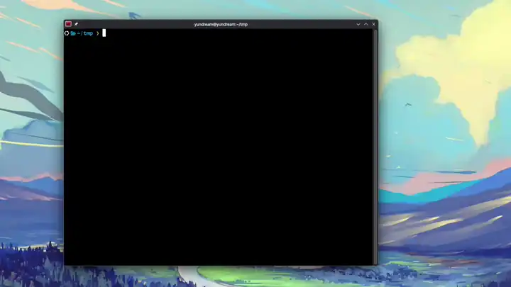
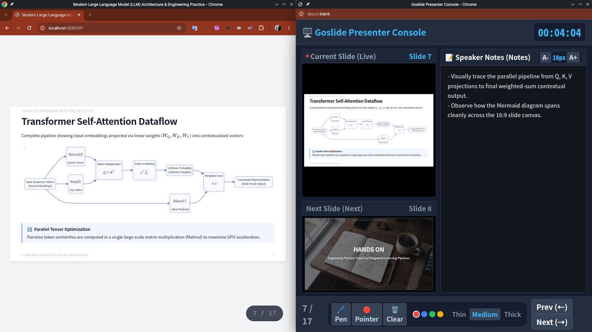
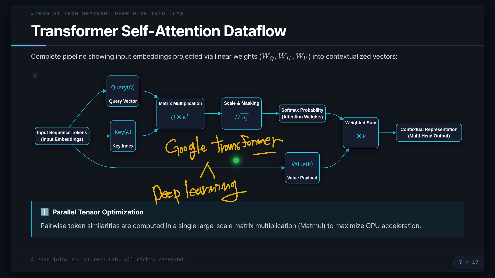
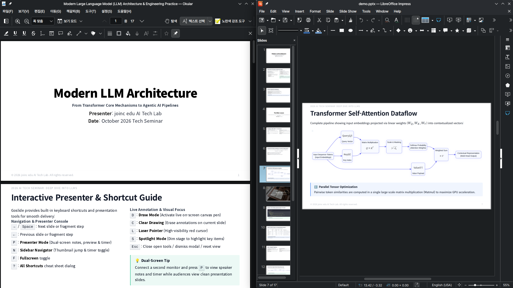

<div align="center">

# Goslide

**A blazing-fast, single-binary Markdown presentation deck builder written in Pure Go.**

Convert Markdown documents into interactive HTML, vector PDF, and editable PPTX with zero external dependencies.  
Tailored for developers, educators, and YouTube screencast lecture recordings.

[English](README.md) | [한국어](README.ko.md) · [3-Min Quickstart](QUICKSTART.md)

<br/>
<br/>

<a href="#quick-start">
  
</a>

<p align="center">
  <sub>⚡ <b>Quick Tour</b>: Instant Launch → Rich Markdown & Code Highlighting → Screencast Canvas (<code>D</code>) → Dual Presenter Console (<code>P</code>)</sub>
</p>

</div>

---

## Features

- **Single Binary & Pure Go**: Zero CGO runtime dependencies. Cross-platform executable (`Linux`, `macOS`, `Windows`) with embedded themes via `embed.FS`.
- **Multi-Format Export**:
  - **Interactive HTML**: Self-contained, responsive web slides with offline support.
  - **Vector PDF**: Crisp, print-ready 16:9 borderless vector PDF powered by headless Chrome.
  - **High-Fidelity PPTX**: Pixel-perfect PowerPoint conversion preserving presenter speaker notes.
- **Real-Time Live Preview**: Ultra-light local dev server (`goslide serve`) using standard Server-Sent Events (SSE) hot reload, keeping your current slide position.
- **Dual-Screen Presenter Console**: Synchronized dual-window presenter view (`P`), digital laser pointer (`L`), and spotlight focus (`S`).
- **Screencast & Live Annotation**: Built-in lightweight transparent canvas overlay designed for YouTube tutorial recording (`D` to toggle pen, `C` to clear).
- **In-App Self-Update**: One-command atomic self-update (`goslide update`) with SHA-256 verification and non-intrusive notification.
- **Multilingual Support**: Native Korean and English localization across CLI (`--lang=ko|en`), presenter console, and drawing UI.
- **Rich Content Ready**: Native syntax highlighting via Chroma, KaTeX math formulas (`$...$`, `$$...$$`), and GitHub Flavored Markdown (GFM) tables.

> [!NOTE]
> HTML presentations and local live server (`goslide serve`) have **zero external runtime dependencies**. Generating vector **PDF** and editable **PPTX** requires **Google Chrome / Chromium** installed on your host system.

---

### Visual Highlights

<p align="center">
  
</p>
<p align="center"><sub>🖥️ <b>Dual-Screen Presenter Console (<code>P</code>)</b>: Synchronized live slide, next slide preview, stopwatch timer, and speaker notes.</sub></p>

<br/>

<p align="center">
  
</p>
<p align="center"><sub>🖊️ <b>Transparent Screencast Canvas (<code>D</code>, <code>L</code>)</b>: Real-time neon pen drawing and digital laser pointer for video tutorials and lecture recordings.</sub></p>

<br/>

<p align="center">
  
</p>
<p align="center"><sub>📦 <b>One Source, Multi-Format Output</b>: Single Markdown source exported simultaneously to interactive HTML, vector PDF, and editable PPTX.</sub></p>

---

## Quick Start

> Note: For a complete step-by-step walkthrough, see the **[3-Minute Quickstart Guide](QUICKSTART.md)**.

### 1. Installation

#### Automated One-Liner (Linux & macOS - Recommended)
```bash
curl -fsSL https://raw.githubusercontent.com/joincdream/goslide/main/install.sh | bash
```

#### In-App Self-Update
Already have Goslide installed? Update in-place to the latest release with one command:
```bash
goslide update          # Upgrade in-place to the latest release
goslide update --check  # Check for updates without modifying binary
```

#### Manual Binary Download
Goslide is distributed as a single static binary with zero CGO runtime dependencies. Download the appropriate pre-compiled archive for your OS and CPU architecture from [GitHub Releases](https://github.com/joincdream/goslide/releases):

| Operating System | CPU Architecture / Target Device | Recommended Artifact |
| :--- | :--- | :--- |
| **macOS** | **Apple Silicon (M1 / M2 / M3 / M4)** | `goslide_darwin_arm64.tar.gz` |
| **macOS** | Intel Processor | `goslide_darwin_amd64.tar.gz` |
| **Linux** | 64-bit Intel / AMD (x86_64) | `goslide_linux_amd64.tar.gz` |
| **Linux** | 64-bit ARM (aarch64 / Raspberry Pi 4, 5) | `goslide_linux_arm64.tar.gz` |
| **Windows** | 64-bit Intel / AMD (x64) | `goslide_windows_amd64.zip` |
| **Windows** | 64-bit ARM (Snapdragon X Elite, etc.) | `goslide_windows_arm64.zip` |

**Linux & macOS Manual Setup:**
```bash
# Extract and install into user PATH
tar -xzf goslide_linux_amd64.tar.gz    # macOS: goslide_darwin_arm64.tar.gz, etc.
chmod +x goslide
mkdir -p ~/.local/bin && cp goslide ~/.local/bin/

# Verify installation
goslide --help
```

> Note (macOS): If blocked by macOS Gatekeeper ("unidentified developer"), run:  
> `xattr -d com.apple.quarantine goslide`

**Windows Setup:**
- Extract the downloaded `.zip` file, move `goslide.exe` to your preferred folder, and add it to your system's `Path` environment variable.

#### Install via Go (Go 1.22+)
```bash
go install github.com/joincdream/goslide/cmd/goslide@latest
```

#### Build from Source
```bash
git clone https://github.com/joincdream/goslide.git
cd goslide
make build
```

---

### 2. 3-Minute Interactive Demo & Live Reload

Goslide embeds a rich 14-slide showcase presentation and customizable themes directly inside the binary:

```bash
# 1. Unpack demo presentation (demo/) and project themes (themes/)
goslide demo

# 2. Launch live preview development server (opens browser automatically)
goslide serve demo/demo.md

# 3. Batch export to HTML, vector PDF, and PowerPoint PPTX simultaneously
goslide build demo/demo.md -f html,pdf,pptx

# 4. Initialize your own presentation
goslide init my-slide.md
```

---

### 3. AI / LLM Assisted Slide & Theme Creation

Leverage AI agents (ChatGPT, Claude, Cursor) to generate slide decks or design custom themes using official specifications:

#### 1) Slide Deck Generation
```bash
# Print AI prompt for slide deck generation (includes official DSL specification URL)
goslide prompt
```
Paste the output into ChatGPT or Claude with your topic (e.g. *"Create an 8-slide presentation on cloud-native microservices architecture"*). The AI will generate production-ready Goslide Markdown DSL instantly.  

> Note: For full syntax and directives, see the [Official Goslide Markdown DSL Specification](docs/dsl-guide.md).

#### 2) Custom Theme CSS Generation
```bash
# Print AI prompt for custom CSS theme generation (includes official 4-Tier DOM architecture URL)
goslide prompt theme
```
Paste the output into your AI tool with your branding requirements (e.g. *"Modern corporate theme with navy blue accent, Inter typography, and light gray cards"*). The AI will craft a self-contained CSS stylesheet tailored for 1920×1080 fixed viewports.  

> Note: For full theme architecture guidelines, see the [Official Goslide Theme CSS Architecture Specification](docs/theme-guide.md).

---

## Keyboard Shortcuts (Presentation & Screencast)

| Key | Description | Context |
| :---: | :--- | :--- |
| `→` / `Space` / `PageDown` / `J` | Next slide / fragment | Presentation |
| `←` / `PageUp` / `K` / `H` | Previous slide / fragment | Presentation |
| `Home` / `End` | Go to first / last slide | Presentation |
| `[Number]` + `Enter` | Jump directly to slide number | Presentation |
| `F` | Toggle fullscreen mode | Presentation |
| **`D`** | **Toggle transparent drawing pen** | **YouTube Recording / Live Screencast** |
| **`C`** | **Clear all drawings on active slide** | **YouTube Recording / Live Screencast** |
| `L` | Toggle digital laser pointer | Presenter Mode |
| `S` | Toggle spotlight mouse focus | Presenter Mode |
| `P` | Open pop-out dual-screen presenter console | Presenter Mode |
| `B` / `W` | Blackout / Whiteout screen curtain | Audience Engagement |
| `1` ~ `4` | Change pen / laser pointer color (Red, Blue, Green, Yellow) | Annotation / Pointer |
| `+` / `-` | Change pen / laser stroke width (Thin, Medium, Thick) | Annotation / Pointer |
| `?` | Open keyboard shortcuts help popup | Help |

---

## Directives & Layout Usage

### Frontmatter (Global Directives)

Declare presentation metadata in the YAML block at the top of the file:

```yaml
---
title: Presentation Title
theme: clean          # Themes: clean, dark, academic, cyber-dark, default
size: 16:9            # Aspect ratio: 16:9 (default) or 4:3
paginate: true        # Show slide numbers (e.g. 3 / 24)
header: Header Text
footer: Footer Text
autofit: true         # Prevent text overflow with dynamic font scaling
---
```

### Scoped Directives (Slide Level)

Control per-slide layout and styling using HTML comments:

- `<!-- layout: cover -->`: Centered layout for title and divider slides.
- `<!-- layout: two-cols -->` (or `<!-- split -->`): 2-column grid layout.
- `<!-- layout: section -->`: Section header layout.
- `<!-- layout: blank -->`: Zero-padding full canvas layout (ideal for diagrams/full-bleed images).
- `<!-- backgroundColor: #1e1e1e -->`: Override background color for active slide.
- `<!-- backgroundImage: url(bg.jpg) -->`: Apply background image.
- `<!-- note: Speaker notes content -->`: Speaker script recorded in presenter console and PPTX notes.

---

## Theme Management & Custom Themes

Goslide is 100% CSS-driven, allowing you to craft custom branded themes with complete layout control.

### 1. Inspect & Export Built-in Themes
```bash
# List available built-in themes (clean, dark, academic, cyber-dark, default)
goslide theme list

# Export built-in theme CSS to local themes/ directory
goslide theme export clean themes/my-company.css
```

### 2. Automatic Custom Theme Discovery
Save your CSS file in the project's `themes/` folder (e.g., `themes/my-company.css`). Goslide discovers it automatically by name in Frontmatter:
```yaml
---
title: "Quarterly Business Review"
theme: my-company      # Automatically discovers themes/my-company.css
---
```

### 3. Master CSS Selector Architecture
| Selector | Purpose | Default Height / Properties |
| :--- | :--- | :--- |
| `.slide-card` | Slide viewport container | Background color, base font color, borders, shadow |
| `.slide-card .slide-header` | Top fixed tracker text | 40px |
| `.slide-card .slide-title-box` | Slide title & subtitle container | 120px |
| `.slide-card .slide-body` | Slide content flexbox container | 840px - 960px |
| `.slide-card .slide-footer` | Bottom footer & slide pagination | 80px |
| `.slide-card.layout-cover` | Cover title layout override | Centered H1 |
| `.slide-card.layout-two-cols` | 2-column grid layout | `.col-left`, `.col-right` |

> Note: For full 4-tier DOM architecture and strict layout guidelines, see the **[Goslide Theme CSS Specification](docs/theme-guide.md)**.

---

## System Architecture

Goslide strictly adheres to a unidirectional, decoupled pipeline architecture:

```
[Markdown Source]
       │
       ▼ (1. Parse)
[Immutable Slide IR] (Deck, Slide, Directives)
       │
       ▼ (2. Transform & Resolve)
[Themed Presentation Model]
       │
       ├───────────────────┼───────────────────┐
       ▼ (3a. Render)      ▼ (3b. Export)      ▼ (3c. Export)
   HTML Renderer       PDF Exporter        PPTX Exporter
   (html/template)       (chromedp)        (OPC zip builder)
```

Detailed specifications:
- [Core Architecture Specification](docs/okf/core-architecture.md)
- [Interfaces & Domain Model Contracts](docs/okf/contracts-interfaces.md)
- [Screencast Annotation Specification](docs/okf/screencast-annotation.md)
- [Hard Constraints & DoD Checklist](docs/okf/hard-constraints.md)

---

## Development & Contributing

```bash
# Run all quality checks (formatting, linter, complexity, race tests)
make check

# Run unit & race condition tests
make test-race

# Run linter
make lint

# Run performance benchmarks
make bench
```

---

## Author & Contact

**yundream (Joinc)**

- **Website**: [https://www.joinc.co.kr](https://www.joinc.co.kr)
- **LinkedIn**: [linkedin.com/in/yundream](https://www.linkedin.com/in/yundream/)
- **Email**: [yundream@gmail.com](mailto:yundream@gmail.com)
- **GitHub**: [@joincdream](https://github.com/joincdream)

---

## License

This project is licensed under the [Apache 2.0 License](LICENSE).
