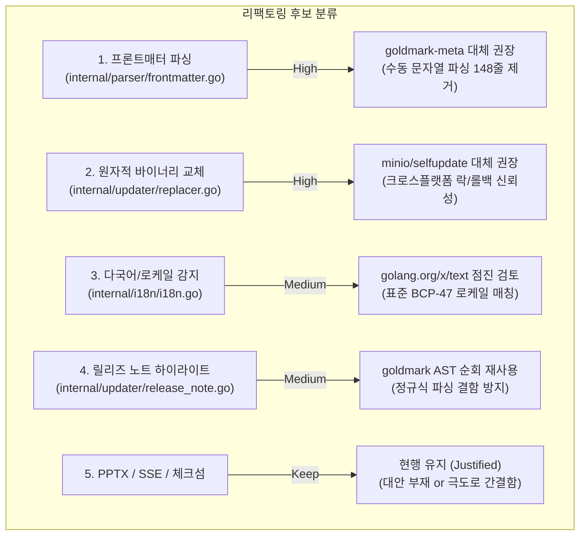

# Goslide 검증된 외부 패키지 대체 및 코드 리팩토링 검토 보고서

> **문서 버전**: v1.0.0  
> **작성 일자**: 2026-10-11  
> **평가 대상**: Goslide 전체 코드베이스 (`internal/`, `cmd/`, `pkg/`)  
> **목적**: 바퀴의 재발명(Reinventing the wheel) 지양 원칙에 따라, 표준/공식 검증 라이브러리가 존재함에도 직접 구현(Hand-rolled)된 코드 영역을 전수 조사하고 리팩토링 타당성을 평가  
> **참조 가이드라인**: [`AGENTS.md`](../../AGENTS.md) (단일 바이너리 및 실용적 의존성 관리, 검증된 공식 도구 우선 원칙)

---

## 1. 개요 및 종합 요약 (Executive Summary)

Goslide는 "단일 바이너리(Pure Go, CGO 0%) 및 의존성 최소화"라는 철학을 추구하는 과정에서, 일부 표준화된 기능들까지 직접 구현하여 유지보수 비용과 코드 복잡도(Cyclomatic/Cognitive Complexity)를 높인 영역들이 존재합니다.

개정된 [`AGENTS.md`](../../AGENTS.md)의 원칙(**"외부 의존성 최소화는 무분별한 패키지 도입이나 OS 의존성을 배제하라는 뜻이지, 표준 규격을 다루는 공식 도구를 배제하고 바퀴를 재발명하라는 의미가 아님"**)에 입각하여 전체 12개 서브패키지를 전수 점검한 결과, **총 4건의 리팩토링 후보 영역**을 발굴했습니다.

---

## 2. 후보 영역별 세부 기술 분석

### [후보 1] 마크다운 프론트매터 파싱 (`internal/parser/frontmatter.go`)
* **우선순위**: 🔴 **높음 (High Priority - 즉시 리팩토링 권장)**
* **대상 코드**: [`internal/parser/frontmatter.go`](file:///mnt/data/myjob/cloit/Goslide/internal/parser/frontmatter.go#L36-L148) (약 148 라인)

#### 현황 및 문제점
* 마크다운 텍스트를 `\n` 단위로 직접 `strings.Split`하고, `---` 구분자 경계를 수동으로 슬라이싱하여 `yaml.Unmarshal`을 호출하는 방식을 직접 구현(Hand-roll)하고 있습니다.
* 마크다운 본문 내에 수평선(`---`)이 존재하거나 다양한 개행 코드(`\r\n`), 탭/스페이스 혼용 시 엣지 케이스 버그를 직접 방어해야 하는 복잡성이 있습니다.

#### 검증된 표준 대안
* **[`github.com/yuin/goldmark-meta`](https://github.com/yuin/goldmark-meta)** (Goldmark 공식 확장)
* Goslide가 마크다운 엔진으로 이미 사용 중인 `goldmark`의 공식 확장 메타데이터 파서입니다.
* Goldmark 파싱 파이프라인의 AST 컨텍스트(`parser.Context`)에 프론트매터 데이터를 네이티브로 주입합니다.

#### 리팩토링 효과
1. 수동 라인 분할 및 구분자 스캔 코드 **100여 줄 제거**.
2. Goldmark 파싱 사이클 내에서 한 번에 메타데이터와 본문이 분리되므로 파싱 속도 향상 및 일관성 확보.

---

### [후보 2] 원자적 바이너리 교체 및 롤백 (`internal/updater/replacer.go`)
* **우선순위**: 🔴 **높음 (High Priority - 안정성 관점 권장)**
* **대상 코드**: [`internal/updater/replacer.go`](file:///mnt/data/myjob/cloit/Goslide/internal/updater/replacer.go#L15-L131) (약 130 라인)

#### 현황 및 문제점
* 현재 `ReplaceBinary`는 임시 파일 생성, `os.Chmod` 권한 복사, `.tmp` 백업 이동, 원자적 `os.Rename`, 실패 시 롤백 로직을 직접 구현하고 있습니다.
* POSIX 환경에서는 잘 작동하지만, **Windows 환경에서 현재 실행 중인 `.exe` 프로세스 파일 락(Access is denied)** 처리, 불완전 종료 시 임시 파일 정리 등 크로스 플랫폼 엣지 케이스를 모두 안전하게 커버하기 어렵습니다.

#### 검증된 표준 대안
* **[`github.com/minio/selfupdate`](https://github.com/minio/selfupdate)** (MinIO 프로젝트의 표준 라이브러리)
* Caddy, MinIO, Terraform Provider 등 수많은 글로벌 프로덕션 CLI 도구들이 채택한 사실상 표준(De-facto standard)입니다.
* Pure Go(CGO 0%)이며, 윈도우 환경에서의 바이너리 덮어쓰기(`MoveFileEx` 트릭)와 퍼미션 보존, 자동 롤백을 완벽히 보장합니다.

#### 리팩토링 효과
1. 복잡한 수동 파일 I/O 및 롤백 코드 제거.
2. 윈도우 및 다양한 유닉스 환경에서의 바이너리 자가 교체 무결성 보장.

---

### [후보 3] 다국어 카탈로그 및 시스템 로케일 감지 (`internal/i18n/i18n.go`)
* **우선순위**: 🟡 **중간 (Medium Priority - 품질 고도화)**
* **대상 코드**: [`internal/i18n/i18n.go`](file:///mnt/data/myjob/cloit/Goslide/internal/i18n/i18n.go#L95-L140) (약 45 라인)

#### 현황 및 문제점
* `DetectLocale()`에서 환경 변수(`LC_ALL`, `LC_MESSAGES`, `LANG`) 문자열을 직접 `_`, `.`, `@`로 파싱하여 로케일을 판별하고 있습니다.
* 지원 언어가 `ko`, `en` 외에 확장될 경우 BCP-47 표준 태그 매칭이나 최적 언어 폴백(Language Negotiation) 처리가 미흡합니다.

#### 검증된 표준 대안
* **[`golang.org/x/text/language`](https://pkg.go.dev/golang.org/x/text/language)** (Go 공식 서브저장소)
* Go 공식 팀이 제공하는 BCP-47 표준 언어 매처(`language.Matcher`, `language.Make`)를 활용.

#### 리팩토링 효과
* 표준 규격 기반의 안정적인 로케일 매칭 및 향후 다국어(ja, zh, de 등) 확장에 유연한 구조 확보.

---

### [후보 4] 릴리즈 노트 하이라이트 파싱 (`internal/updater/release_note.go`)
* **우선순위**: 🟡 **중간 (Medium Priority - 일관성 개선)**
* **대상 코드**: [`internal/updater/release_note.go`](file:///mnt/data/myjob/cloit/Goslide/internal/updater/release_note.go#L13-L48) (약 48 라인)

#### 현황 및 문제점
* 마크다운 릴리즈 노트 본문에서 불릿 포인트를 추출하고 링크(`[...] (...)`)와 볼드(`**...**`) 서식을 제거하기 위해 정규식(`mdLinkRegex`, `boldRegex`)과 라인 분할을 사용하고 있습니다.
* 복합 인라인 서식(예: 링크 안에 볼드가 있거나 백틱 코드가 포함된 경우) 파싱 누락 위험이 있습니다.

#### 검증된 표준 대안
* 기존에 임포트된 **`github.com/yuin/goldmark`**의 AST 워커(`ast.Walk`) 재사용.
* 추가 외부 의존성 없이 이미 프로젝트에 있는 Goldmark AST를 순회하여 `ast.KindListItem`의 텍스트만 추출.

#### 리팩토링 효과
* 정규식 오류 방지 및 마크다운 파싱 도구의 일관된 단일화.

---

## 3. 현행 유지가 타당한 영역 (Justified Hand-Rolled Codes)

조사 과정에서 검토되었으나, **외부 라이브러리를 도입하지 않고 현재 자체 구현을 유지하는 것이 더 우수한 영역들**입니다.

| 모듈 및 파일 | 구현 내용 | 현행 유지 사유 |
| :--- | :--- | :--- |
| **`internal/exporter/pptx/template.go`** | OpenXML raw XML 템플릿 및 ZIP 압축 | Go 생태계에 가볍고 신뢰할 만한 순수 Go PPTX 라이브러리가 부재함(상용 UniOffice 외 대안 없음). HTML 캡처 이미지를 16:9 슬라이드로 배치하는 최소주의 OpenXML 패키징 방식이 가장 가볍고 결정론적임. |
| **`internal/server/server.go`** | 간이 SSE (Server-Sent Events) 브로드캐스터 | 채널과 뮤텍스를 이용한 약 30줄의 간결한 고루틴 구조로, 별도 웹소켓/SSE 라이브러리 도입 없이 표준 `net/http`로 완벽히 동작함. |
| **`internal/updater/verifier.go`** | SHA-256 체크섬 파일 파서 및 해시 검증 | 표준 라이브러리(`crypto/sha256`, `bufio.Scanner`)를 활용한 40줄 미만의 명확한 구현체로 외부 도구 불필요. |

---

## 4. 리팩토링 종합 제안 및 마일스톤 로드맵

| 단계 | 리팩토링 대상 파일 | 도입 라이브러리 | 주된 효과 |
| :---: | :--- | :--- | :--- |
| **1단계** | [`internal/parser/frontmatter.go`](file:///mnt/data/myjob/cloit/Goslide/internal/parser/frontmatter.go) | `github.com/yuin/goldmark-meta` | 수동 문자열 슬라이싱 148줄 제거, Goldmark AST 통합 |
| **2단계** | [`internal/updater/replacer.go`](file:///mnt/data/myjob/cloit/Goslide/internal/updater/replacer.go) | `github.com/minio/selfupdate` | 윈도우/유닉스 원자적 교체 및 롤백 완전 보장, 복잡도 제거 |
| **3단계** | [`internal/updater/release_note.go`](file:///mnt/data/myjob/cloit/Goslide/internal/updater/release_note.go) | `github.com/yuin/goldmark` (AST 재사용) | 정규식 서식 제거의 엣지 케이스 해소, 파서 단일화 |
| **4단계** | [`internal/i18n/i18n.go`](file:///mnt/data/myjob/cloit/Goslide/internal/i18n/i18n.go) | `golang.org/x/text/language` | BCP-47 표준 태그 매칭 및 다국어 확장 기반 마련 |

---

## 5. 결론

Goslide는 마크다운(`goldmark`), 구문 강조(`chroma`), CLI(`cobra`), 브라우저 제어(`chromedp`), SemVer(`golang.org/x/mod/semver`) 등 핵심 영역에서는 검증된 도구를 잘 활용하고 있습니다. 

그러나 **프론트매터 파싱(`frontmatter.go`)**과 **자가 업데이트 파일 교체(`replacer.go`)** 2곳은 검증된 표준 도구(`goldmark-meta`, `minio/selfupdate`)로 대체할 경우 **코드베이스의 라인 수를 200줄 이상 절감하고 크로스 플랫폼 안정성을 크게 향상**시킬 수 있습니다.
