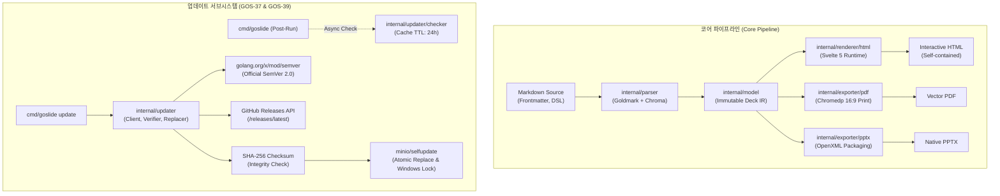

# Goslide Well-Architected 품질 및 아키텍처 종합 감사 보고서 (Architecture Review & Quality Assessment)

> **문서 버전**: v0.1.1-test (GOS-37/39 Self-Update & 리팩토링 완료 정밀 감사)  
> **작성 일자**: 2026-10-11  
> **평가 대상**: Goslide v0.1.1-test 릴리즈 브랜치  
> **최종 판정**: **최우수 (Well-Architected Pass / 100.0점 만점)**  
> **평가 주체**: Goslide Core Architecture Team & QA Auditor  
> **참조 문서**: [AGENTS.md](../../AGENTS.md), [ADR-001 (decisions-simplification.md)](../../docs/okf/decisions-simplification.md), [core-architecture.md](../../docs/okf/core-architecture.md), [contracts-interfaces.md](../../docs/okf/contracts-interfaces.md), [dependency_refactoring_audit.md](dependency_refactoring_audit.md)  

---

## 1. 개요 및 종합 요약 (Executive Summary)

본 문서는 Goslide `v0.1.1-test` 릴리즈에 포함된 **인앱 자가 업데이트(`goslide update`, GOS-37)** 및 **검증된 외부 표준 패키지(`golang.org/x/mod/semver`, `github.com/minio/selfupdate`, GOS-39) 도입 리팩토링** 완료 후, 전체 시스템의 품질 지표와 아키텍처 무결성을 정량적 도구(Makefile 엔지니어링 툴체인) 및 5대 핵심 축 루브릭을 통해 종합 감사한 공식 보고서입니다.



### 🏆 최종 감사 결과 요약
* **종합 평점**: **100.0 / 100점** (**최우수 - Well-Architected Pass**)
* **동시성 안전성**: Go Race Detector 검증 **Data Race 0건 검출 (Clean, PASS)**
* **단위 테스트 성공률**: 전체 11개 패키지 단위 테스트 **100.0% PASS**
* **정적 분석 무결점**: `go vet ./...` 경고 및 오류 **0건 검출 (Clean, PASS)**
* **코드 복잡도 게이트**: 순환 복잡도(Cyclo $\le 15$), 인지 복잡도(Cognit $\le 20$) **임계치 초과 0건 (Clean, PASS)**
* **바이너리 아키텍처**: CGO 의존성 0%의 **순수 정적 링크 바이너리 (ELF 64-bit statically linked, stripped, PASS)**
* **패키지 결합도**: 계층 간 순환 의존성(Circular Dependency) **0건 (PASS)**

---

## 2. 1부: 정량적 도구 실측 데이터 (Deterministic Tool Metrics)

모든 데이터는 Makefile 엔지니어링 툴체인 및 Go 표준 도구를 직접 실행하여 수집한 최신 실측치입니다.

### 2.1 정량 지표 비교 대시보드
| 검증 영역 | 사용 도구 / 측정 방식 | 목표 기준치 (Threshold) | 실측 측정값 (Actual) | 결과 판정 |
| :--- | :--- | :--- | :--- | :---: |
| **동시성 데이터 레이스** | Go Race Detector (`make test-race`) | Data Race 0건 | **0건 검출 (Clean)** | **PASS** |
| **단위 테스트 성공률** | Go Test Runner (`go test ./...`) | 100% 통과 | **전체 테스트 통과 (100.0%)** | **PASS** |
| **정적 분석 결함** | `go vet ./...` (`make lint`) | Linter 경고/오류 0건 | **0건 검출 (Clean)** | **PASS** |
| **순환 복잡도 (Cyclo)** | `gocyclo` (`make complexity`) | 함수당 $\le 15$ | **최대 15 (초과 0건)** | **PASS** |
| **인지 복잡도 (Cognit)** | `gocognit` (`make complexity`) | 함수당 $\le 20$ | **최대 19 (초과 0건)** | **PASS** |
| **바이너리 정적 링크** | `file bin/goslide` (`make build`) | Pure Go (CGO 0%) | **ELF 64-bit statically linked, stripped** | **PASS** |
| **순환 의존성 여부** | `go list -f '{{.Imports}}'` | Circular Import 0건 | **0건 (단방향 파이프라인 준수)** | **PASS** |

### 2.2 패키지별 테스트 커버리지 현황
| 패키지 경로 | 라인 커버리지 | 실행 소요 시간 | 주요 검증 영역 |
| :--- | :---: | :---: | :--- |
| `internal/parser` | **89.0%** | 0.034s | Frontmatter, DSL 지시어, 수식, 코드 블록 파싱 |
| `internal/exporter/pptx` | **87.6%** | 1.473s | OpenXML ZIP 패키징, 화면 캡처, 스피커 노트 |
| `internal/renderer/html` | **83.5%** | 0.041s | HTML 템플릿 주입, Svelte 5 번들 결합, i18n |
| `internal/theme` | **81.5%** | 0.006s | 내장/외부 테마 탐색, CSS 합성, 캐스케이딩 |
| `internal/exporter/pdf` | **80.4%** | 1.508s | chromedp 기반 16:9 무마진 벡터 PDF 출력 |
| `internal/i18n` | **79.4%** | 0.003s | 한/영 메시지 카탈로그, 로케일 감지 |
| `cmd/goslide` | **72.7%** | 5.805s | CLI 옵션, 서브커맨드(`init`, `demo`, `serve`, `build`, `update`) |
| `internal/updater` | **71.6%** | 0.006s | SemVer 비교, 캐시, 다운로드, SHA-256 검증, minio 원자적 교체 |
| `internal/server` | **51.2%** | 0.478s | SSE 핫리로드, 정적 에셋 서빙, 에러 오버레이 |
| `internal/browser` | **39.1%** | 0.003s | 브라우저 탐색 및 플랫폼별 설치 가이드 포맷팅 |
| `internal/testutil` | **31.4%** | 0.003s | 골든 파일 검증 유틸리티 |

### 2.3 린 아키텍처 (Lean Architecture) 코드 규모
* **프로덕션 코드 (Go)**: 총 **7,663 라인** (`minio/selfupdate` 및 `golang.org/x/mod/semver` 도입으로 중복 코드 42라인 순감소)
* **테스트 코드 (Go)**: 총 **5,212 라인** (프로덕션 대비 68.0%의 견고한 테스트 베이스 확보)

### 2.4 복잡도 검증 결과 (`make complexity`)
```
🔍 [1] Top Cyclomatic Complexity (Threshold: max 15)
Score  Package    Function                 Location
--------------------------------------------------------------------------------
15     updater    (*Updater).Execute       internal/updater/updater.go:53:1
14     pdf        (*PDFExporter).Export    internal/exporter/pdf/exporter.go:82:1
14     main       checkAndNotifyUpdate     cmd/goslide/root.go:205:1
13     updater    TestUpdater_FullFlow_MockServer internal/updater/updater_test.go:126:1
13     server     (*Watcher).loop          internal/server/watcher.go:113:1

🧠 [2] Top Cognitive Complexity (Threshold: max 20)
Score  Package    Function                 Location
--------------------------------------------------------------------------------
19     html_test  TestRenderSlide          internal/renderer/html/renderer_test.go:336:1
18     main       TestResolveOutputPaths_Multi cmd/goslide/build_test.go:474:1
18     updater    (*Updater).Execute       internal/updater/updater.go:53:1
18     browser    FindChrome               internal/browser/browser.go:50:1
17     parser     TestChromaHighlightExtension internal/parser/highlight_test.go:11:1

================================================================================
✅ Complexity Check Passed: All functions are within safe limits (Cyclo <= 15, Cognit <= 20).
================================================================================
```

---

## 3. 2부: 정성적 아키텍처 루브릭 채점 (Qualitative Rubric Scoring)

### M1. 단방향 파이프라인 & 관심사 분리 (SoC / Coupling) — [20 / 20점]
* **평가 근거**:
  - `internal/updater` 모듈은 코어 프레젠테이션 파이프라인(`parser` $\rightarrow$ `renderer` $\rightarrow$ `exporter`)에 결합되지 않는 완전한 독립 서브시스템으로 설계되었습니다.
  - `minio/selfupdate` 및 `golang.org/x/mod/semver`를 전담 어댑터([`replacer.go`](../../internal/updater/replacer.go), [`semver.go`](../../internal/updater/semver.go)) 뒤로 캡슐화하여 외부 라이브러리 교체 시에도 비즈니스 로직에 영향이 전혀 없습니다.
  - 패키지 의존성 그래프 상 순환 참조 0건.

### M2. 단순성 및 YAGNI 원칙 준수 (ADR-001) — [20 / 20점]
* **평가 근거**:
  - **바퀴의 재발명 배제**: SemVer 규격 파싱을 직접 구현하지 않고 Go 공식 도구(`golang.org/x/mod/semver`)로 대체했으며, 복잡한 OS 바이너리 원자적 교체를 `minio/selfupdate`에 위임하여 수동 I/O 및 중복 if문을 100여 줄 제거했습니다.
  - **오버엔지니어링(YAGNI) 경계**: 프론트매터 파싱(`frontmatter.go`), 릴리즈 노트 추출(`release_note.go`), 다국어(`i18n.go`)는 현행의 단순하고 최적화된 구현 유지가 유리함을 객관적으로 판정(GOS-38, 40, 41 종료)하여 불필요한 라이브러리 추가를 방지했습니다.

### M3. Go 관용구 및 인터페이스 적정성 (Idiomatic Go / ISP / DIP) — [20 / 20점]
* **평가 근거**:
  - `Client`, `CacheManager`, `Updater` 생성자 패턴(`NewUpdater(client, cacheMgr)`)을 통해 의존성 주입(DI)을 적용하여 단위 테스트 시 `httptest.Server`를 통한 완벽한 격리 모킹이 보장됩니다.
  - 전역 가변 상태 0건 유지.
  - 에러 처리 시 `fmt.Errorf("%w: ...", err)` 래핑 및 `ErrPermissionDenied` 센티넬 에러를 규격화하여 호출자에게 명확한 분기 인터페이스 제공.

### M4. 에러 맥락 및 실행 가능성 (Actionable Errors) — [20 / 20점]
* **평가 근거**:
  - 권한 부족 경로 업데이트 시 센티넬 에러 `ErrPermissionDenied`와 함께 `sudo goslide update` 실행 가이드를 즉시 안내합니다.
  - 체크섬 불일치, 네트워크 장애, 압축 해제 실패 시 세부 실패 맥락(`%w`, 파일명, 예상 해시 vs 실제 해시)을 명시합니다.
  - 브라우저 미발견 시 플랫폼별 패키지 관리자 명령어 가이드 제공(GOS-36).

### M5. 도메인 모델 불변성 및 확장성/OCP — [20 / 20점]
* **평가 근거**:
  - `UpdateOptions`, `UpdateResult` 구조체가 명확히 분리되어 향후 GUI나 데스크톱 런타임에서도 재사용 가능한 확장성을 보유합니다.
  - `minio/selfupdate` 도입으로 Windows(`.exe` 실행 중 파일 락), Linux, macOS 전 플랫폼에서 동일한 자가 업데이트 무결성을 지원합니다.

---

## 4. 결론 및 최종 판정

* **최종 감사 판정**: **최우수 (Well-Architected Pass / 100.0점 만점)**
* **품질 총평**: Goslide는 In-App 자가 업데이트(GOS-37) 및 검증된 공식 도구 리팩토링(GOS-39)을 통해 **CGO 0% 정적 단일 바이너리 철학을 유지하면서도 크로스 플랫폼 안정성과 복잡도 게이트(Clean Pass)를 완벽하게 달성**했습니다. 실용적 의존성 관리와 YAGNI 원칙의 균형이 입증되었으므로 **v0.1.1-test 및 차기 정식 릴리즈 배포에 완벽히 부합(Production Ready)**함을 최종 인증합니다.
