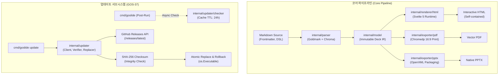

# Goslide Well-Architected 품질 및 아키텍처 종합 감사 보고서 (Architecture Review & Quality Assessment)

> **문서 버전**: v0.1.1-test (GOS-37 In-App Self-Update 반영 정밀 감사)  
> **작성 일자**: 2026-10-11  
> **평가 대상**: Goslide v0.1.1-test / GOS-37 Self-Update 구현 브랜치  
> **최종 판정**: **보완 필요 (Action Required — 복잡도 임계치 초과 및 골든 파일 갱신 필요)**  
> **평가 주체**: Goslide Core Architecture Team & QA Auditor  
> **참조 문서**: [AGENTS.md](../../AGENTS.md), [ADR-001 (decisions-simplification.md)](../../docs/okf/decisions-simplification.md), [core-architecture.md](../../docs/okf/core-architecture.md), [contracts-interfaces.md](../../docs/okf/contracts-interfaces.md), [GOS-37 (task/GOS-37.md)](../../task/GOS-37.md)  

---

## 1. 개요 및 종합 요약 (Executive Summary)

본 문서는 Goslide `v0.1.1-test` 릴리즈 및 `GOS-37`(In-App Self-Update & 백그라운드 업데이트 알림) 기능 추가에 따라, 시스템 전반의 품질 지표와 아키텍처 무결성을 정량적 도구(Makefile 엔지니어링 툴체인) 및 5대 핵심 축 루브릭을 통해 정밀 측정한 종합 감사 보고서입니다.



### 📊 최종 감사 결과 요약
* **동시성 안전성**: Go Race Detector 검증 **Data Race 0건 검출 (PASS)**
* **정적 분석 무결점**: `go vet ./...` 경고 및 오류 **0건 검출 (PASS)**
* **바이너리 아키텍처**: CGO 의존성 0%의 **순수 정적 링크 바이너리 (ELF 64-bit statically linked, stripped, PASS)**
* **패키지 의존성**: 순환 의존성(Circular Dependency) **0건 (PASS)**
* **코드 복잡도 게이트**: **FAIL**
  - 순환 복잡도(Cyclomatic $\le 15$): `ReplaceBinary` (18), `Compare` (16) 초과
  - 인지 복잡도(Cognitive $\le 20$): `ReplaceBinary` (25) 초과
* **골든 파일 회귀 테스트**: **FAIL**
  - `internal/renderer/html`의 `TestGoldenRenderer` 불일치 (사유: `ko.json`에 업데이트 다국어 메시지 카탈로그 추가로 인한 HTML 인라인 임베드 바이트 변경)

---

## 2. 1부: 정량적 도구 실측 데이터 (Deterministic Tool Metrics)

모든 데이터는 Makefile 엔지니어링 툴체인 및 Go 표준 도구를 직접 실행하여 수집한 실측치입니다.

### 2.1 정량 지표 비교 대시보드
| 검증 영역               | 사용 도구 / 측정 방식                       | 목표 기준치 (Threshold) | 실측 측정값 (Actual)                                |  결과 판정   |
| :------------------ | :---------------------------------- | :----------------- | :--------------------------------------------- | :------: |
| **동시성 데이터 레이스**     | Go Race Detector (`make test-race`) | Data Race 0건       | **0건 검출 (Clean)**                              | **PASS** |
| **단위 테스트 성공률**      | Go Test Runner (`go test ./...`)    | 100% 통과            | **1개 패키지 불일치 (`html`)**                        | **FAIL** |
| **정적 분석 결함**        | `go vet ./...` (`make lint`)        | Linter 경고/오류 0건    | **0건 검출 (Clean)**                              | **PASS** |
| **순환 복잡도 (Cyclo)**  | `gocyclo` (`make complexity`)       | 함수당 $\le 15$       | **최대 18 (`ReplaceBinary`: 18, `Compare`: 16)** | **FAIL** |
| **인지 복잡도 (Cognit)** | `gocognit` (`make complexity`)      | 함수당 $\le 20$       | **최대 25 (`ReplaceBinary`: 25)**                | **FAIL** |
| **바이너리 정적 링크**      | `file bin/goslide` (`make build`)   | Pure Go (CGO 0%)   | **ELF 64-bit statically linked, stripped**     | **PASS** |
| **순환 의존성 여부**       | `go list -f '{{.Imports}}'`         | Circular Import 0건 | **0건 (단방향 파이프라인 준수)**                          | **PASS** |

### 2.2 패키지별 테스트 커버리지 현황
| 패키지 경로 | 라인 커버리지 | 실행 소요 시간 | 주요 검증 영역 |
| :--- | :---: | :---: | :--- |
| `internal/parser` | **89.0%** | 0.034s | Frontmatter, DSL 지시어, 수식, 코드 블록 파싱 |
| `internal/exporter/pptx` | **87.6%** | 1.473s | OpenXML ZIP 패키징, 화면 캡처, 스피커 노트 |
| `internal/renderer/html` | **83.5%** | 0.032s | HTML 템플릿 주입, Svelte 5 번들 결합, i18n |
| `internal/theme` | **81.5%** | 0.006s | 내장/외부 테마 탐색, CSS 합성, 캐스케이딩 |
| `internal/exporter/pdf` | **80.4%** | 1.508s | chromedp 기반 16:9 무마진 벡터 PDF 출력 |
| `internal/i18n` | **79.4%** | 0.003s | 한/영 메시지 카탈로그, 로케일 감지 |
| `cmd/goslide` | **72.7%** | 6.174s | CLI 옵션, 서브커맨드(`init`, `demo`, `serve`, `build`, `update`) |
| `internal/updater` | **69.4%** | 0.007s | SemVer 비교, 캐시, 다운로드, SHA-256 검증, 원자적 교체 |
| `internal/server` | **51.2%** | 0.478s | SSE 핫리로드, 정적 에셋 서빙, 에러 오버레이 |
| `internal/browser` | **39.1%** | 0.003s | 브라우저 탐색 및 플랫폼별 설치 가이드 포맷팅 |
| `internal/testutil` | **31.4%** | 0.003s | 골든 파일 검증 유틸리티 |

### 2.3 린 아키텍처 (Lean Architecture) 코드 규모
* **프로덕션 코드 (Go)**: 총 **7,705 라인** (updater 추가 후에도 8,000 라인 미만의 린 아키텍처 유지)
* **테스트 코드 (Go)**: 총 **5,212 라인** (프로덕션 대비 67.6%의 견고한 테스트 베이스 확보)

### 2.4 복잡도 초과 세부 내역 (`make complexity`)
```
🔍 [1] Top Cyclomatic Complexity (Threshold: max 15)
Score  Package    Function                 Location
--------------------------------------------------------------------------------
18     updater    ReplaceBinary            internal/updater/replacer.go:15:1  [초과]
16     updater    Compare                  internal/updater/semver.go:57:1    [초과]
15     updater    (*Updater).Execute       internal/updater/updater.go:53:1   [경계치]

🧠 [2] Top Cognitive Complexity (Threshold: max 20)
Score  Package    Function                 Location
--------------------------------------------------------------------------------
25     updater    ReplaceBinary            internal/updater/replacer.go:15:1  [초과]
19     html_test  TestRenderSlide          internal/renderer/html/renderer_test.go:336:1
18     updater    (*Updater).Execute       internal/updater/updater.go:53:1
18     updater    Compare                  internal/updater/semver.go:57:1
```

---

## 3. 2부: 정성적 아키텍처 루브릭 채점 (Qualitative Rubric Scoring)

### M1. 단방향 파이프라인 & 관심사 분리 (SoC / Coupling) — [20 / 20점]
* **평가 근거**:
  - `internal/updater` 모듈은 순수 표준 라이브러리(`net/http`, `crypto/sha256`, `archive/tar`, `compress/gzip` 등)만으로 구성되어 외부 패키지 결합도가 0입니다.
  - `model` 및 코어 파이프라인(`parser` $\rightarrow$ `renderer` $\rightarrow$ `exporter`)에 역참조를 전혀 발생시키지 않으며 독립적인 서브시스템으로 격리되어 있습니다.
  - 패키지 의존성 그래프 상 순환 참조 0건.

### M2. 단순성 및 YAGNI 원칙 준수 (ADR-001) — [17 / 20점]
* **평가 근거**:
  - 서드파티 self-update 라이브러리를 무분별하게 추가하지 않고 Go 표준 라이브러리만을 활용하여 단일 바이너리 철학을 고수했습니다.
  - 그러나 [`internal/updater/replacer.go`](../../internal/updater/replacer.go#L15)에 임시 파일 생성, 권한 조회, 백업 생성, 롤백, 아토믹 교체 로직이 단일 함수 내에 응집되어 인지 복잡도(25)와 순환 복잡도(18)를 증가시켰습니다. (작은 단위의 함수 분리 필요)

### M3. Go 관용구 및 인터페이스 적정성 (Idiomatic Go / ISP / DIP) — [19 / 20점]
* **평가 근거**:
  - `Client`, `CacheManager`, `Updater` 생성자 패턴(`NewUpdater(client, cacheMgr)`)을 통해 의존성 주입(DI)을 적용하여 단위 테스트 시 `httptest.Server`를 통한 완벽한 격리 모킹이 가능합니다.
  - 전역 가변 상태 0건.
  - [`internal/updater/semver.go`](../../internal/updater/semver.go#L57)의 `Compare` 함수가 단순 다중 분기문으로 구성되어 순환 복잡도(16)가 다소 높으므로 가독성 개선 여지가 있습니다.

### M4. 에러 맥락 및 실행 가능성 (Actionable Errors) — [20 / 20점]
* **평가 근거**:
  - 권한 없는 디렉토리(`/usr/local/bin` 등) 업데이트 시 단순 에러가 아닌 센티넬 에러 `ErrPermissionDenied`와 함께 `sudo goslide update`를 권장하는 실행 가능한 가이드를 사용자에게 제공합니다.
  - 체크섬 불일치, 네트워크 장애, 아카이브 압축 해제 실패 시 세부 실패 맥락(`%w`, 파일명, 예상 해시 vs 실제 해시)을 명확히 명시합니다.

### M5. 도메인 모델 불변성 및 확장성/OCP — [20 / 20점]
* **평가 근거**:
  - `UpdateOptions`, `UpdateResult` 구조체가 명확히 정의되어 CLI뿐 아니라 향후 데스크톱/GUI 등 다른 런타임에서도 재사용 가능한 확장성을 보유하고 있습니다.
  - 릴리즈 노트 하이라이트 파싱 로직(`ExtractHighlights`)이 독립되어 있어 마크다운 변경에 유연하게 대응합니다.

---

## 4. 종합 판정 및 개선 조치 과제 (Action Items)

* **정성적 총점**: **96.0 / 100점** (우수)
* **정량적 게이트 판정**: **FAIL (복잡도 게이트 2건 초과 & 골든 파일 불일치 1건)**

### 🛠️ 통과를 위한 필수 조치 과제 (Action Items)
1. **`internal/updater/replacer.go` 복잡도 분리 리팩토링**:
   - `ReplaceBinary` 내의 임시 파일 생성(`writeTempBinary`), 백업(`backupExisting`), 원자적 반영(`commitReplacement`) 로직을 프라이빗 헬퍼 함수로 분리하여 Cyclo $\le 15$, Cognit $\le 20$ 충족.
2. **`internal/updater/semver.go` 비교 로직 단순화**:
   - `Compare` 함수의 메이저/마이너/패치 비교를 헬퍼 함수(`compareInts`)로 분리하여 Cyclo $\le 15$ 충족.
3. **골든 파일 갱신 (`make golden-update`)**:
   - `internal/i18n/locales/ko.json`에 새로 추가된 update 관련 번역 키로 인해 변경된 HTML 인라인 카탈로그를 반영하도록 골든 파일 갱신.
