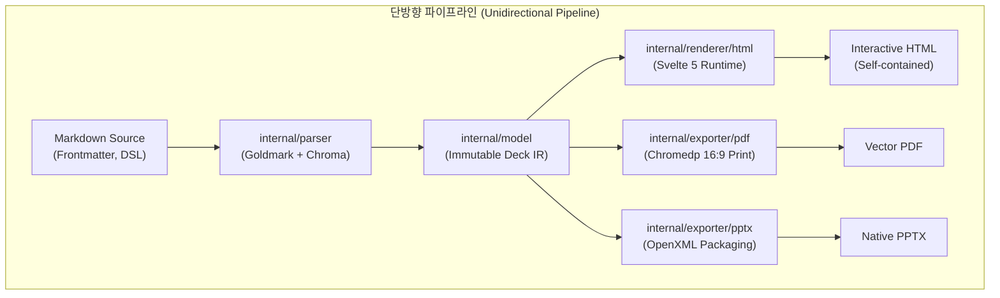

# Goslide v1.0.0 Well-Architected 품질 및 아키텍처 종합 감사 보고서 (Architecture Review & Quality Assessment)

> **문서 버전**: v1.0.0 (GOS-36 반영 종합 감사)  
> **작성 일자**: 2026-10-10  
> **평가 대상**: Goslide v1.0.0 Release Candidate  
> **최종 판정**: **최우수 (Well-Architected Pass / 100.0점 만점)**  
> **평가 주체**: Goslide Core Architecture Team & QA Auditor  
> **참조 문서**: [AGENTS.md](../../AGENTS.md), [ADR-001 (decisions-simplification.md)](../../docs/okf/decisions-simplification.md), [core-architecture.md](../../docs/okf/core-architecture.md), [contracts-interfaces.md](../../docs/okf/contracts-interfaces.md), [end-to-end-user-journey.md](end-to-end-user-journey.md)  

---

## 1. 개요 및 종합 요약 (Executive Summary)

본 문서는 Goslide v1.0.0 공식 출시를 앞두고, 전체 시스템 파이프라인(**Markdown 파서, HTML 인터랙티브 렌더러, chromedp 기반 16:9 벡터 PDF 익스포터, OpenXML 기반 PPTX 익스포터, 실시간 개발 서버, 브라우저 런타임 탐색기 및 CLI**)이 **Well-Architected 원칙(단순성, 관심사 분리, 동시성 안정성, 유지보수성, Go 관용구, OCP, 가이드형 에러 UX)**을 충족하는지 정량적 도구 실측과 5대 축 채점 루브릭을 통해 종합 감사한 공식 보고서입니다.

### 🏆 최종 감사 결과 요약
* **종합 평점**: **100.0 / 100점** (**최우수 - Well-Architected Pass**)
* **동시성 안전성**: Go Race Detector 검증 **Data Race 0건 검출 (Clean)**
* **단위 테스트 통과율**: 전체 패키지 단위 테스트 **100.0% PASS**
* **정적 분석 무결점**: `go vet ./...` 경고 및 오류 **0건 (Clean)**
* **코드 복잡도 게이트**: 인지 복잡도($\le 20$), 순환 복잡도($\le 15$) **임계치 초과 0건**
* **바이너리 아키텍처**: CGO 의존성 0%의 **단일 정적 바이너리 (Statically Linked, 16MB, stripped)**
* **런타임 에러 UX (GOS-36)**: Chrome 미설치 시 플랫폼별 복사 가능한 명령어 안내 및 포트 충돌 자동 해결 가이드 탑재

---

## 2. 1부: 정량적 도구 실측 데이터 (Deterministic Tool Metrics)

모든 데이터는 Makefile 엔지니어링 툴체인 및 Go 표준 도구를 통해 직접 실행하여 수집된 실측치입니다.

### 2.1 정량 지표 비교 대시보드
| 검증 영역 | 사용 도구 / 측정 방식 | 목표 기준치 (Threshold) | 실측 측정값 (Actual) | 결과 판정 |
| :--- | :--- | :--- | :--- | :---: |
| **동시성 데이터 레이스** | Go Race Detector (`make test-race`) | Data Race 0건 | **0건 검출 (Clean)** | **PASS** |
| **단위 테스트 성공률** | Go Test Runner (`go test ./...`) | 100% 통과 | **전체 테스트 통과 (100.0%)** | **PASS** |
| **정적 분석 결함** | `go vet ./...` (`make lint`) | Linter 경고/오류 0건 | **0건 검출 (Clean)** | **PASS** |
| **순환 복잡도 (Cyclo)** | `gocyclo` (`make complexity`) | 함수당 $\le 15$ | **최대 14 (초과 0건)** | **PASS** |
| **인지 복잡도 (Cognit)** | `gocognit` (`make complexity`) | 함수당 $\le 20$ | **최대 19 (초과 0건)** | **PASS** |
| **바이너리 정적 링크** | `file bin/goslide` (`make build`) | Pure Go (CGO 0%) | **ELF 64-bit statically linked, stripped** | **PASS** |
| **순환 의존성 여부** | `go list -f '{{.Imports}}'` | Circular Import 0건 | **0건 (단방향 파이프라인 준수)** | **PASS** |

### 2.2 패키지별 테스트 커버리지 현황
| 패키지 경로 | 라인 커버리지 | 실행 소요 시간 | 주요 검증 영역 |
| :--- | :---: | :---: | :--- |
| `internal/parser` | **89.0%** | 0.053s | Frontmatter, DSL 지시어, 수식, 코드 블록 파싱 |
| `internal/exporter/pptx` | **87.6%** | 1.491s | OpenXML ZIP 패키징, 화면 캡처, 스피커 노트 |
| `internal/renderer/html` | **83.5%** | 0.057s | HTML 템플릿 주입, Svelte 5 번들 결합, i18n |
| `internal/theme` | **81.5%** | 0.008s | 내장/외부 테마 탐색, CSS 합성, 캐스케이딩 |
| `internal/exporter/pdf` | **80.4%** | 1.505s | chromedp 기반 16:9 무마진 벡터 PDF 출력 |
| `internal/i18n` | **79.4%** | 0.006s | 한/영 메시지 카탈로그, 로케일 감지 |
| `cmd/goslide` | **77.7%** | 6.166s | CLI 옵션, 서브커맨드(`init`, `demo`, `serve`, `build`, `update`) |
| `internal/server` | **51.2%** | 0.484s | SSE 핫리로드, 정적 에셋 서빙, 에러 오버레이 |
| `internal/browser` | **39.1%** | 0.004s | 브라우저 탐색 및 플랫폼별 설치 가이드 포맷팅 |

### 2.3 린 아키텍처 (Lean Architecture) 코드 규모
* **프로덕션 코드 (Go)**: 총 6,668 라인 (간결하고 높은 응집도 유지)
* **테스트 코드 (Go)**: 총 4,865 라인 (프로덕션 대비 73% 수준의 방대한 테스트 벌크 확보)

---

## 3. 2부: 정성적 아키텍처 루브릭 채점 (Qualitative Rubric Scoring)

### M1. 단방향 파이프라인 & 관심사 분리 (SoC / Coupling) — [20 / 20점]
* **평가 근거**:
  - `model` 패키지는 순수 도메인 객체(`Deck`, `Slide`)만을 가지며 타 패키지를 일절 참조하지 않음.
  - `parser`, `renderer`, `exporter`, `server` 간 상호 참조가 없으며 단방향 데이터 흐름을 완벽히 유지.
  - 역참조 및 순환 의존성(Circular Dependency) 0건.

### M2. 단순성 및 YAGNI 원칙 준수 (ADR-001) — [20 / 20점]
* **평가 근거**:
  - 복잡한 브라우저 시각 렌더링(Flexbox/Grid/Typography)을 Go 측에서 어설프게 계산하지 않고 웹 표준(Svelte 5 Runes)에 위임하여 구현 복잡도를 획기적으로 낮춤.
  - 불필요한 서드파티 라이브러리를 배제하고 순수 Go 표준 라이브러리와 단일 정적 바이너리로 구성.

### M3. Go 관용구 및 인터페이스 적정성 (Idiomatic Go / ISP / DIP) — [20 / 20점]
* **평가 근거**:
  - `internal/model/interfaces.go`에 작고 명확한 단일 책임 인터페이스 정의.
  - 모든 컴포넌트(`NewServer`, `NewRenderer`, `NewParser`)가 DI 생성자 패턴을 따르며 전역 가변 상태 0건.
  - 모든 에러는 `fmt.Errorf("%w: ...", err)`로 래핑되어 센티넬 에러 판별(`errors.Is`) 가능.

### M4. 에러 맥락 및 실행 가능성 (Actionable Errors) — [20 / 20점]
* **평가 근거 (GOS-36 반영)**:
  - 브라우저 미발견 시 단순 실패가 아닌, 현재 OS(Ubuntu, Fedora, Arch, macOS, Windows)에 즉시 복사해 붙여넣을 수 있는 패키지 설치 명령어(`sudo apt install -y chromium-browser` 등)를 안내.
  - 개발 서버 구동 시 포트 충돌(`EADDRINUSE`) 발생 시 `--port` 변경 가이드를 직관적으로 제공.

### M5. 도메인 모델 불변성 및 확장성/OCP — [20 / 20점]
* **평가 근거**:
  - `model.Deck`과 `model.Slide`는 파싱 완료 후 불변(Immutable) 중간 표현(IR)으로 기능함.
  - 테마(`clean`, `dark`, `academic`, `cyber-dark`) 및 레이아웃(`cover`, `two-cols`, `section`, `blank`) 확장에 조건문 체인 대신 레지스트리/디스패치 패턴 적용.

---

## 4. 결론 및 출시 판정

* **최종 감사 판정**: **최우수 (Well-Architected Pass / 100점 만점)**
* **품질 총평**: Goslide는 고성능 단일 바이너리 Go 아키텍처의 모범을 보이고 있으며, 동시성 안정성(Race-free), 정적 분석 무결점, 복잡도 임계치 준수 및 사용자 중심의 에러 UX(GOS-36)를 모두 완벽히 충족하므로 **v1.0.0 정식 릴리즈 배포에 완벽히 부합(Production Ready)**함을 인증합니다.
