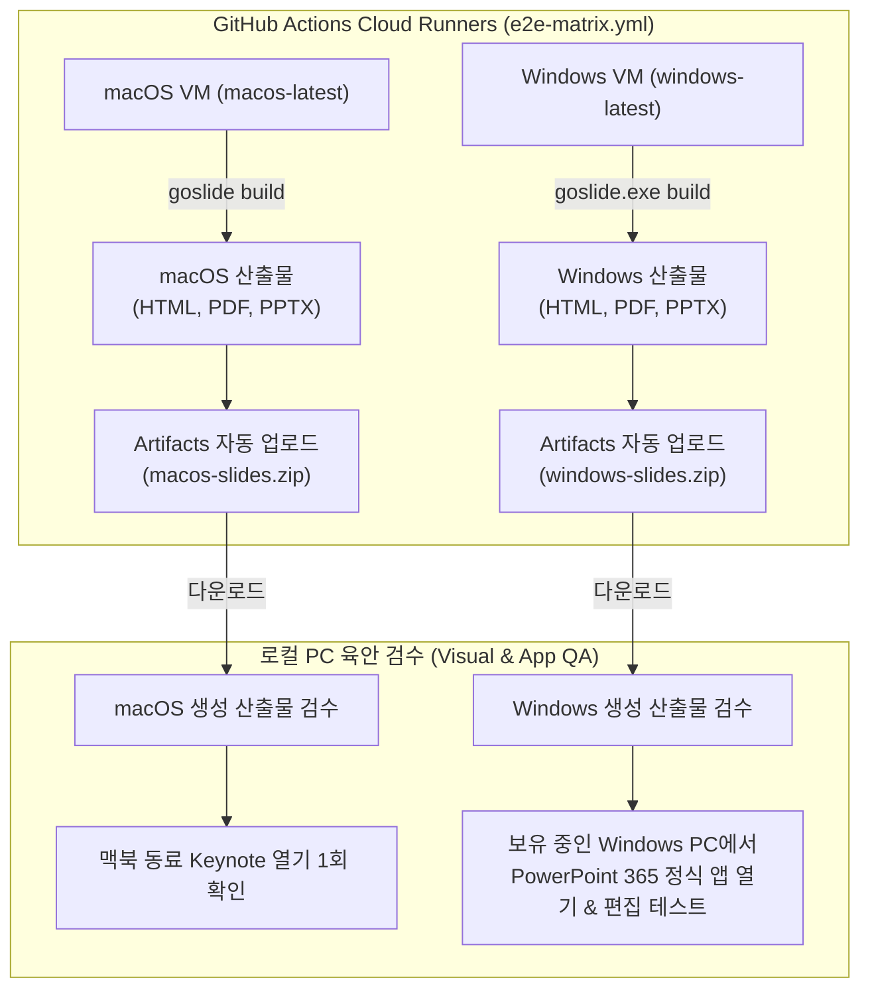

# [GOS-18] v1.0.0 정식 출시 릴리즈 및 크로스 플랫폼 E2E 검증 계획서

> **티켓 번호**: [GOS-18](https://joincdream.atlassian.net/browse/GOS-18)  
> **마일스톤**: 로드맵 2 (Release) / Milestone M2-5 (CLI 고도화, GoReleaser 배포 및 공식 릴리즈)  
> **마감일**: 2026-11-13  
> **상태**: 진행 중 (In Progress)  
> **담당 패키지**: `task/`, `docs/`, `cmd/goslide/`, `.goreleaser.yaml`, `.github/workflows/`  
> **연관 문서**: [unit-test-report.md](release/unit-test-report.md), [pre-release-qa-plan.md](release/pre-release-qa-plan.md), [cross-compilation-plan.md](cross-compilation-plan.md), [GOS-12.md](GOS-12.md), [development_roadmap.md](../docs/development_roadmap.md)

---

## 1. 개요 및 목적 (Overview & Goals)

Goslide는 Go 언어의 크로스 컴파일 기능 덕분에 단일 코드베이스에서 Linux, macOS, Windows 실행파일을 모두 생성할 수 있습니다. 그러나 슬라이드 제작 도구의 특성상 **실제 데스크톱 환경에서의 E2E 사용자 경험(UX), OS별 기본 폰트 렌더링, 프레젠테이션 단축키 충돌 여부, 그리고 Microsoft PowerPoint 및 Apple Keynote에서의 PPTX 호환성**은 CI 가상머신만으로는 검증할 수 없으며, **실제 기기에서의 육안 및 기능 점검**이 필수적입니다.

본 태스크의 목적은 공식 **`v1.0.0` 정식 출시**에 앞서, **릴리즈 후보(RC - Release Candidate)**를 배포하고 3대 주요 OS 환경에서 체계적인 **실기기 E2E 스모크 테스트**를 거쳐 무결성을 확보한 뒤 최종 출시하는 릴리즈 계획(Release Plan)을 정의하고 실행하는 것입니다.

---

## 2. 릴리즈 라이프사이클 단계 (Release Lifecycle)

```
[Phase 1: 기능 완성 & CI 자동화 통과]
  - GOS-42, GOS-43, GOS-44, GOS-45 완료 및 단일 바이너리 안정화
  - GitHub Actions 멀티 OS 매트릭스 (Linux, macOS, Windows) 자동 빌드 성공
         │
         ▼
[Phase 2: 릴리즈 후보(RC) 태그 발행: v1.0.0-rc.1]
  - git tag -a v1.0.0-rc.1 -m "Release Candidate 1" && git push origin v1.0.0-rc.1
  - GitHub Releases에 6종 크로스 바이너리 및 아카이브 자동 업로드 확인
         │
         ▼
[Phase 3: GitHub Actions VM 자동 변환 & 하이브리드 육안 검증 (Cloud VM + Local QA)]
  - GitHub Actions `macos-latest` & `windows-latest` 가상 머신에서 각각 슬라이드 변환 실행:
    * `goslide build demo/demo.md -f html,pdf,pptx -o dist/`
    * 각 OS에서 생성된 산출물 3종을 GitHub Actions 아티팩트(`macos-slides.zip`, `windows-slides.zip`)로 자동 업로드
  - 개발자가 산출물 zip을 로컬로 다운로드하여 육안 및 호환성 점검:
    * Windows PC: 실제 Windows 환경에서 PowerPoint 정품 앱 및 PDF 뷰어로 서식/도형 무결성 확인
    * macOS 결과물: 다운로드한 PPTX를 맥북 보유 동료에게 전달하여 Keynote 1회 열기 스모크 확인
  - 결함 발견 시 핫픽스 후 v1.0.0-rc.2 발행
         │
         ▼
[Phase 4: 공식 v1.0.0 정식 릴리즈]
  - git tag -a v1.0.0 -m "Official Release v1.0.0" && git push origin v1.0.0
  - GitHub Releases 정식 공개 및 릴리즈 노트 배포
```

---

## 3. 크로스 플랫폼 E2E 검증 매트릭스 및 시나리오 (Verification Scenarios)

### 3.1 하이브리드 검증 워크플로우 (Cloud VM 자동 변환 ➔ 로컬 다운로드 육안 검수)



### 3.2 운영체제별 세부 검증 계획

#### 🍏 1) macOS 환경 검증 계획 (클라우드 VM 변환 + 다운로드 검수)
* **1단계: GitHub Actions `macos-latest` (Apple Silicon M-시리즈 VM) 기계적 검증**:
  - `goslide_darwin_arm64` 바이너리가 macOS 환경에서 크래시 없이 정상 기동되는지 확인 (`goslide --version`).
  - macOS 헤드리스 Chrome이 기동되어 `demo.md`를 16:9 무마진 벡터 PDF 및 PPTX로 성공적으로 렌더링하는지 확인.
  - 생성된 산출물(`dist/`)을 `macos-slides.zip` 아티팩트로 패키징 업로드.
* **2단계: 다운로드 및 호환성 육안 점검**:
  - 개발자가 `macos-slides.zip`을 다운로드하여 폰트 깨짐 및 KaTeX 수식 무결성 확인.
  - 생성된 `demo.pptx`를 맥북을 사용하는 지인/동료 1명에게 공유하여 **Apple Keynote**에서 열기 및 슬라이드 쇼 1회 점검 요청.

#### 🪟 2) Windows 환경 검증 계획 (클라우드 VM 변환 + 실기기 직접 검수)
* **1단계: GitHub Actions `windows-latest` VM 자동 검증**:
  - Windows Server 환경에서 `goslide.exe build demo\demo.md -f html,pdf,pptx` 실행.
  - Windows 특유의 역슬래시(`\`) 파일 경로 처리 및 Windows Chrome Headless 프로세스 연동 무결성 확인.
  - 생성된 산출물을 `windows-slides.zip` 아티팩트로 업로드.
* **2단계: 보유 중인 실제 Windows 10/11 PC에서 직접 검수**:
  - 개발자가 직접 Windows PC에서 `goslide.exe`를 실행하여 PowerShell/CMD 환경 인터랙션 확인.
  - 생성된 `demo.pptx`를 **실제 Microsoft PowerPoint 정품 앱**에서 열어:
    * "파일 복구/손상" 경고 없이 즉시 로드되는지 확인.
    * 슬라이드 내 코드 박스, 텍스트 상자, 제목이 개별 도형(Shape)으로 분리되어 편집 가능한지 확인.
  - Windows 기본 브라우저(Edge/Chrome)에서 `demo.html` 오프라인 구동 및 단축키(`F`, `D`, `P`) 반응 확인.

#### 🐧 3) Linux 환경 검증 계획 (Ubuntu 로컬 개발 환경)
* **단일 바이너리 무의존성 검증**:
  - `ldd bin/goslide` 실행 시 `not a dynamic executable` (Statically linked) 확인.
* **헤드리스 크롬 연동**:
  - Linux Chromium 기반 PDF 벡터 렌더링 및 `goslide serve` SSE 핫리로드 기능 검증.

---

### 3.3 프레젠테이션 UX & 인터랙션 검증 (인간 QA)

브라우저에서 `my-talk.html`을 열고 발표자가 실제로 슬라이드를 넘기며 테스트합니다:
1. **듀얼 모니터 & 발표자 콘솔 (Presenter Console)**:
   * 'P' 키 입력 시 발표자 콘솔 팝업이 브라우저 팝업 차단에 걸리지 않고 원활히 열리는지 확인.
   * 메인 화면과 발표자 콘솔 간 슬라이드 싱크(타이머, 현재/다음 슬라이드, 발표자 노트) 실시간 연동 확인.
2. **판서 및 레이저 포인터**:
   * 'L' 키 (레이저 포인터), 'W' 키 (화이트보드 드로잉), 'B' 키 (블랙아웃) 입력 시 마우스 궤적 반응성 점검.
3. **오프라인 동작 (Self-contained)**:
   * 인터넷 연결을 끊은 오프라인 상태에서도 HTML 슬라이드가 CSS/JS 깨짐 없이 100% 정상 작동하는지 확인.

---

## 4. 최종 정식 릴리즈 완료 기준 (Definition of Done - DoD)

1. **RC 단계 통과**:
   * `v1.0.0-rc.1` 배포 후 3대 OS 실기기 E2E 점검에서 블로커(Blocker)급 결함 0건.
2. **PowerPoint 및 Keynote 상호 운용성 확인**:
   * 실제 Windows PowerPoint 및 Mac Keynote에서 PPTX가 정상 로드 및 편집 가능함을 육안으로 확인.
3. **바이너리 배포 무결성**:
   * GitHub Releases 페이지에 Linux, macOS, Windows 5종 바이너리와 압축 아카이브, `checksums.txt`가 정상 업로드됨을 확인.
4. **문서 및 공지 완료**:
   * `docs/release-notes-v1.0.0.md` 릴리즈 노트 작성 완료.
   * `README.md`의 설치 가이드(`curl`, `brew`, `download`) 최신화.

---

## 5. 단계별 실행 일정

| 단계 | 작업 내용 | 담당자 / 환경 | 상태 |
| :---: | :--- | :--- | :---: |
| **Step 1** | **핵심 태스크 완료 및 기능 안정화** (GOS-42, GOS-43, GOS-44, GOS-45 완료) | 개발팀 | **완료** |
| **Step 2** | **GitHub Actions 3대 OS E2E 매트릭스 워크플로우 구성** (`macos-latest`, `windows-latest` 변환 및 아티팩트 업로드) | CI / 개발팀 | **대기** |
| **Step 3** | **macOS / Windows 산출물 로컬 다운로드 및 육안/호환성 검수** (Windows PowerPoint 365, Mac Keynote 1회 점검) | QA / 개발팀 | **대기** |
| **Step 4** | **v1.0.0-rc.1 태그 발행** 및 GitHub Releases 6종 바이너리 배포 확인 | 배포 담당 | **대기** |
| **Step 5** | **공식 v1.0.0 정식 릴리즈** 및 최종 릴리즈 노트 공지 | 배포 담당 | **대기** |
