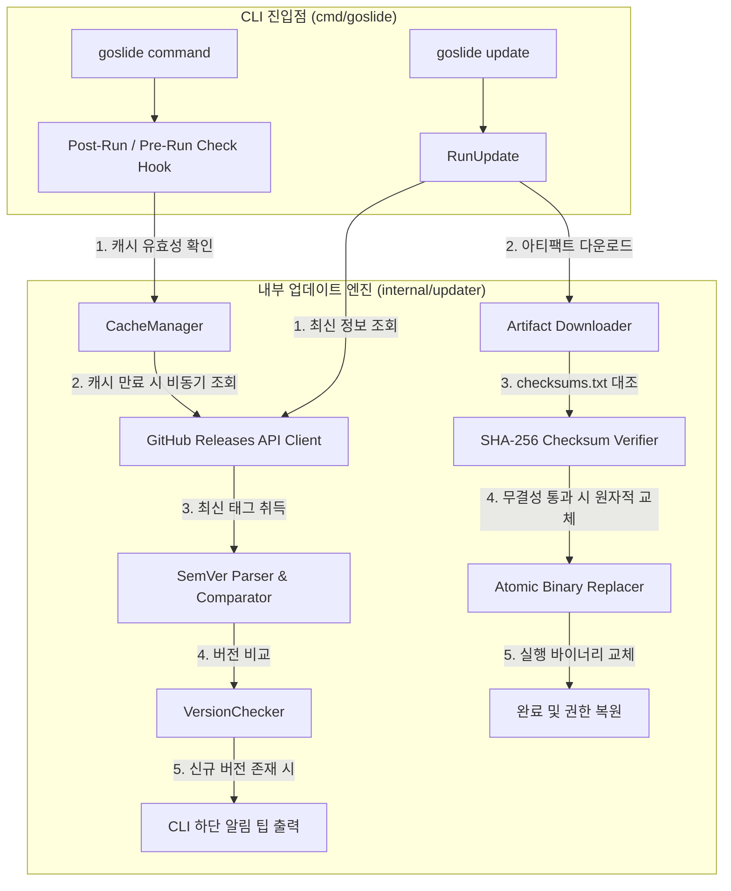
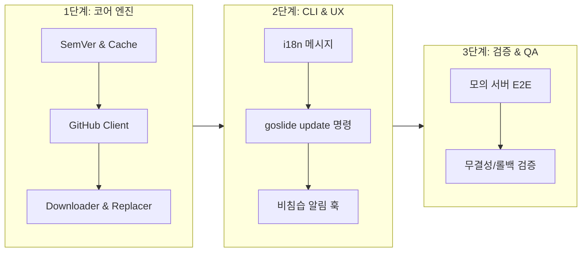

# [GOS-37] CLI 자체 바이너리 인앱 업데이트(goslide update) 및 신규 버전 자동 알림 구현 계획서

> **티켓 번호**: [GOS-37](https://joincdream.atlassian.net/browse/GOS-37)  
> **마일스톤**: v1.0.0 CLI Polish & Self-Update Lifecycle  
> **마감일**: 2026-11-15  
> **상태**: 진행 중 (In Progress)  
> **담당 패키지**:  
> - [`internal/updater/`](file:///mnt/data/myjob/cloit/Goslide/internal/updater/) *(신규: 버전 체커, 캐시 관리, GitHub Releases 연동, 아티팩트 다운로더 및 원자적 교체 엔진)*  
> - [`cmd/goslide/`](file:///mnt/data/myjob/cloit/Goslide/cmd/goslide/) *(`update.go` 서브커맨드 신설, `root.go` 실행 시 비침습적 업데이트 알림 훅)*  
> - [`internal/i18n/`](file:///mnt/data/myjob/cloit/Goslide/internal/i18n/) *(다국어 알림 및 업데이트 진행 메시지 추가)*  
> **연관 문서**:  
> - [`task/GOS-18.md`](file:///mnt/data/myjob/cloit/Goslide/task/GOS-18.md) *(v1.0.0 릴리즈 및 크로스 플랫폼 배포 계획)*  
> - [`docs/okf/core-architecture.md`](file:///mnt/data/myjob/cloit/Goslide/docs/okf/core-architecture.md) *(단일 바이너리 및 파이프라인 아키텍처)*  
> - [`docs/okf/hard-constraints.md`](file:///mnt/data/myjob/cloit/Goslide/docs/okf/hard-constraints.md) *(CGO 배제 및 리소스 안전성 가드레일)*  

---

## 1. 개요 및 배경 (Context & Objective)

### 1.1 배경 및 문제의식
현재 Goslide는 단일 실행 바이너리로 배포되며, 새로운 기능이나 버그 패치가 포함된 신규 릴리즈가 출시되었을 때 다음과 같은 사용자 경험(UX) 마찰이 존재합니다:

1. **신규 릴리즈 인지 부재**:
   - 사용자는 공식 GitHub Releases 페이지를 직접 방문하거나 공지를 확인하기 전까지 자신이 구버전 바이너리를 사용하고 있다는 사실을 인지하기 어렵습니다.
2. **수동 업데이트 번거로움**:
   - 새 버전 설치를 위해 GitHub Releases에서 OS/아키텍처에 맞는 압축 파일(`.tar.gz` / `.zip`)을 찾아 다운로드하고, 압축을 해제한 후, 기존 바이너리 경로(예: `/usr/local/bin/goslide` 또는 `~/bin/goslide`)로 수동 덮어쓰기해야 합니다.
3. **환경별 권한 문제 및 무결성 미검증**:
   - 수동 설치 과정에서 파일 실행 권한(`chmod +x`) 누락이나 SHA-256 해시 검증 생략으로 인한 손상된 바이너리 실행 위험이 있습니다.

### 1.2 개발 목표 (Objectives)
* **비침습적 신규 버전 자동 감지 & 유도 (Background Update Notifier)**:
  - 사용자가 `goslide` 명령어(예: `build`, `serve` 등)를 실행할 때, 백그라운드에서 최신 릴리즈 유무를 확인하고 새 버전이 존재할 경우 터미널 하단에 `goslide update` 실행을 권장하는 친절한 알림 팁을 출력합니다.
  - 네트워크 지연으로 인한 CLI 실행 방해를 원천 차단하기 위해 **24시간 캐시(TTL)** 및 **비동기/논블로킹(Non-blocking)** 방식으로 동작합니다.
* **원클릭 인앱 셀프 업데이트 (`goslide update`)**:
  - `goslide update` 명령어를 통해 최신 릴리즈 탐색 $\rightarrow$ 다운로드 $\rightarrow$ SHA-256 체크섬 무결성 검증 $\rightarrow$ 원자적 파일 교체(Atomic Replacement)까지 한 번에 안전하게 수행합니다.
* **순수 Go 기반 Zero-Dependency & 크로스 플랫폼 지원**:
  - 외부 CGO 라이브러리 없이 Go 표준 라이브러리(`net/http`, `crypto/sha256`, `archive/tar`, `compress/gzip`, `archive/zip`)만으로 Linux, macOS(Darwin), Windows를 완벽 지원합니다.
* **i18n 다국어 완벽 지원**:
  - 한국어(`ko`) 및 영어(`en`) 환경에 맞춰 모든 안내 문구와 진행 상황 메시지를 자연스럽게 로컬라이즈합니다.

---

## 2. 사용자 경험 및 시나리오 (User Experience & UX Flow)

### 2.1 시나리오 A: 일상적인 CLI 실행 시 신규 버전 알림 (Update Notifier)

```
$ goslide build presentation.md
[goslide] 🚀 Building presentation.md -> presentation.html (theme: clean)
[goslide] ✨ Successfully built presentation.html (160 KB, 12 slides)

💡 A new version of Goslide is available: v0.1.0 -> v0.2.0
   Release notes: https://github.com/joincdream/goslide/releases/tag/v0.2.0
   Run 'goslide update' to upgrade automatically.
```

- **동작 원칙**:
  1. CLI 실행 본연의 속도를 늦추지 않음 (캐시 미만료 시 네트워크 호출 0ms).
  2. 로컬 캐시(`~/.goslide/update_check.json`)가 24시간 초과되었을 때만 비동기로 GitHub Releases API를 조회.
  3. CI 환경(`CI=true`), 파이프라인, 비대화형 터미널(No TTY), 또는 `--quiet` 플래그에서는 알림을 억제하여 스크립트 실행의 순수성을 보장.

### 2.2 시나리오 B: 사용자가 `goslide update` 실행 (Self-Update & Release Notes)

```
$ goslide update
[goslide] 🔍 Checking for latest release...
[goslide] 📦 Current version: v0.1.0-dev, Latest version: v0.2.0
[goslide] ⬇️  Downloading goslide_0.2.0_linux_amd64.tar.gz (18.4 MB)...
[goslide] 🔒 Verifying SHA-256 checksums... OK
[goslide] 🔄 Replacing binary /usr/local/bin/goslide...
[goslide] 🎉 Successfully updated Goslide to v0.2.0!

📋 What's New in v0.2.0:
  • feat(update): In-app self-update & background notification (#37)
  • feat(i18n): Full Korean/English runtime support (#34)
  • fix(html): Fix golden test reproducibility across environments

👉 View full release notes at:
   https://github.com/joincdream/goslide/releases/tag/v0.2.0
```

- **이미 최신 버전인 경우**:
  ```
  $ goslide update
  [goslide] 🔍 Checking for latest release...
  [goslide] ✨ You are already using the latest version of Goslide (v0.2.0).
  ```
- **권한 부족 시 안내**:
  - 만약 설치 경로에 쓰기 권한이 없을 경우 친절한 해결 가이드 출력:
    `[goslide] ❌ Permission denied while updating /usr/local/bin/goslide. Please run with 'sudo goslide update'.`

---

## 3. 시스템 아키텍처 및 상세 설계 (Target Architecture)

### 3.1 모듈 파이프라인 다이어그램



### 3.2 핵심 컴포넌트 설계

#### 3.2.1 경량 시맨틱 버전 비교 유틸리티 (`semver.go`)
- 외부 무거운 semver 패키지 없이 순수 Go로 `vX.Y.Z[-prerelease]` 포맷을 파싱하고 비교하는 `Compare(v1, v2 string) int` 구현.
- 개발 버전(`v0.1.0-dev` 등)에 대한 처리 규칙 정의:
  - 로컬 빌드/개발 버전인 경우에도 사용자가 테스트할 수 있도록 안전하게 처리.

#### 3.2.2 비침습적 업데이트 체커 및 캐시 매니저 (`checker.go`, `cache.go`)
- **캐시 경로**: `~/.goslide/update_check.json` (사용자 홈 디렉토리).
- **캐시 스키마**:
  ```json
  {
    "last_checked_at": "2026-10-11T09:00:00Z",
    "latest_version": "v0.2.0",
    "release_url": "https://github.com/joincdream/goslide/releases/tag/v0.2.0"
  }
  ```
- **조회 정책**:
  - `time.Since(lastChecked) < 24*time.Hour`인 경우 네트워크 I/O 없이 즉시 캐시값 반환 (0ms 부하).
  - 캐시 만료 시 HTTP GET `https://api.github.com/repos/joincdream/goslide/releases/latest` 요청 (타임아웃 2초, 취소 가능한 `context.Context` 적용).
  - 네트워크 장애 또는 GitHub API Rate Limit(403) 발생 시 오류를 사용자에게 표출하지 않고 무시(Silent Fail)하여 본래 명령어 실행에 영향 없음.

#### 3.2.3 아티팩트 다운로더 및 무결성 검증기 (`downloader.go`, `verifier.go`)
- **아티팩트 명명 규칙** (GoReleaser 표준 규격):
  - 아카이브: `goslide_{version}_{os}_{arch}.(tar.gz|zip)`
    - Linux / macOS: `.tar.gz`
    - Windows: `.zip`
  - 체크섬: `checksums.txt` (모든 배포 파일의 SHA-256 해시 목록)
- **검증 흐름**:
  1. `checksums.txt` 다운로드 및 파싱.
  2. 현재 환경(`runtime.GOOS`, `runtime.GOARCH`)에 맞는 아카이브 다운로드 (진행률 표시 옵션).
  3. 다운로드된 바이트 스트림의 `crypto/sha256` 해시 계산 후 `checksums.txt`의 해시와 불일치 시 즉시 중단 및 에러 반환.

#### 3.2.4 원자적 바이너리 교체 및 롤백 엔진 (`replacer.go`)
- 실행 중인 바이너리 파일은 OS에 따라 직접 덮어쓰기가 불가능(특히 Windows의 파일 락)할 수 있습니다.
- **표준 안전 교체 알고리즘**:
  1. 현재 실행 파일 경로 획득: `execPath, err := os.Executable()`, 심볼릭 링크 해석(`filepath.EvalSymlinks`).
  2. 바이너리가 위치한 동일 디렉토리에 임시 파일 생성 (`goslide.tmp.<rand>`).
  3. 압축 아카이브에서 `goslide` 바이너리만 추출하여 임시 파일에 기록하고, 기존 파일의 권한(`0755`) 복사.
  4. 기존 실행 파일을 백업 파일(`goslide.old.<rand>`)로 이동(`os.Rename`).
  5. 임시 파일을 원래 실행 파일 경로로 이동(`os.Rename`).
  6. 백업 파일 제거 (Windows의 경우 프로세스 종료 시 자동 삭제 스케줄링 또는 클린업).
  7. 실패 시 백업 파일을 원래 경로로 즉시 복구(Rollback).

#### 3.2.5 릴리즈 노트 파서 및 터미널 뷰어 (`release_note.go`)
- **데이터 모델 확장 (`client.go`)**:
  ```go
  type ReleaseInfo struct {
      Version     string    `json:"tag_name"`
      ReleaseURL  string    `json:"html_url"`   // GitHub Release 웹 페이지 URL
      ReleaseBody string    `json:"body"`       // 마크다운 릴리즈 노트 본문
      PublishedAt time.Time `json:"published_at"`
      Assets      []Asset   `json:"assets"`
  }
  ```
- **터미널 요약 추출 로직 (`ExtractHighlights`)**:
  - GitHub가 생성한 마크다운 `ReleaseBody`에서 불릿 목록(`* `, `- `)을 파싱하여 최대 3~5개의 핵심 변경사항을 슬라이싱.
  - 마크다운 링크 문법(`[#37](...)` 등)을 터미널 가독성에 맞게 텍스트로 정제.
- **안내 링크 출력**:
  - 업데이트 성공 후 또는 알림 팁 출력 시 공식 릴리즈 노트 웹 링크(`ReleaseURL`)를 명확히 제시하여 상세 PR/기여자/설명을 확인할 수 있도록 유도.

---

## 4. 패키지 및 디렉토리 레이아웃

```
Goslide/
├── cmd/
│   └── goslide/
│       ├── root.go          # CLI 실행 후 비침습적 업데이트 알림 팁 출력 연동
│       ├── update.go        # 신규 'goslide update' 서브커맨드 선언 및 실행
│       └── update_test.go   # update 커맨드 플래그 및 실행 테스트
├── internal/
│   ├── updater/             # [NEW] 인앱 업데이트 비즈니스 로직
│   │   ├── checker.go       # 최신 버전 확인 및 캐시 오케스트레이션
│   │   ├── cache.go         # ~/.goslide/update_check.json 디스크 캐시 I/O
│   │   ├── client.go        # GitHub Releases API HTTP 클라이언트 (ReleaseInfo)
│   │   ├── semver.go        # SemVer 파싱 및 버전 대소 비교
│   │   ├── downloader.go    # OS/Arch별 아티팩트 다운로드 및 압축 해제
│   │   ├── verifier.go      # checksums.txt 파싱 및 SHA-256 대조
│   │   ├── replacer.go      # 실행 중 바이너리 원자적 교체 및 롤백
│   │   ├── release_note.go  # 릴리즈 노트 파서 및 터미널 하이라이트 요약 뷰어
│   │   └── updater_test.go  # 모의 HTTP 서버 기반 E2E 단위 테스트
│   └── i18n/
│       └── locales/
│           ├── en.json      # update.* 및 cli.update.* 영문 메시지
│           └── ko.json      # update.* 및 cli.update.* 국문 메시지
└── task/
    └── GOS-37.md            # 본 계획서 문서
```

---

## 5. i18n 다국어 카탈로그 확장 항목

[`internal/i18n/locales/`](file:///mnt/data/myjob/cloit/Goslide/internal/i18n/locales/)에 다음 번역 키를 추가합니다:

| 키 (Key) | 한국어 (`ko.json`) | 영어 (`en.json`) |
| :--- | :--- | :--- |
| `cli.update.desc` | Goslide 바이너리를 최신 버전으로 자동 업데이트합니다 | Automatically update Goslide binary to the latest version |
| `cli.update.long` | 공식 GitHub Releases에서 최신 버전을 확인하고 무결성을 검증한 뒤 자체 바이너리를 교체합니다. | Checks for the latest release from GitHub Releases, verifies integrity, and self-updates the binary. |
| `update.checking` | 최신 릴리즈 버전을 확인하는 중... | Checking for the latest release... |
| `update.already_latest` | 현재 최신 버전(%s)을 사용 중입니다. | You are already using the latest version of Goslide (%s). |
| `update.found_new` | 새로운 버전이 발견되었습니다: %s (현재: %s) | A new version is available: %s (current: %s) |
| `update.downloading` | 최신 아티팩트 다운로드 중 (%s)... | Downloading latest artifact (%s)... |
| `update.verifying` | SHA-256 체크섬 무결성 검증 중... | Verifying SHA-256 checksum integrity... |
| `update.replacing` | 바이너리 교체 중 (%s)... | Replacing binary (%s)... |
| `update.success` | Goslide가 성공적으로 %s 버전으로 업데이트되었습니다! | Goslide has been successfully updated to %s! |
| `update.whats_new` | 📋 %s 주요 변경 사항: | 📋 What's New in %s: |
| `update.release_notes_link` | 👉 상세한 릴리즈 노트는 아래 링크에서 확인하세요:\n   %s | 👉 View full release notes at:\n   %s |
| `update.tip` | 💡 새로운 Goslide 버전(%s)이 있습니다. (현재: %s)\n   - 릴리즈 노트: %s\n   - 'goslide update'를 실행하여 업그레이드하세요. | 💡 A new version of Goslide is available: %s -> %s\n   - Release notes: %s\n   - Run 'goslide update' to upgrade automatically. |
| `update.err_permission` | 바이너리 파일 교체 권한이 없습니다. 'sudo goslide update'로 다시 실행해 주세요. | Permission denied while replacing binary. Please run with 'sudo goslide update'. |

---

## 6. 구현 단계 및 세부 마일스톤 (Action Items)



| 단계 | 주요 작업 내용 | 담당 모듈 | 산출물 및 검증 |
| :--- | :--- | :--- | :--- |
| **1단계: 코어 엔진** | SemVer 비교, 캐시 I/O, GitHub API 클라이언트, 다운로더, SHA-256 검증기, 원자적 교체 엔진, 릴리즈 노트 파서 | `internal/updater/` | 단위 테스트 통과 및 무결성 검증 |
| **2단계: CLI & UX** | i18n 메시지 등록, `goslide update` 서브커맨드(릴리즈 노트 터미널 요약 및 웹 링크 출력), CLI 실행 시 알림 훅 연동 | `cmd/goslide/`, `internal/i18n/` | 다국어 출력, 릴리즈 노트 링크 및 비침습 팁 출력 확인 |
| **3단계: 검증 & QA** | 모의 HTTP 서버 기반 E2E 테스트, 권한 부족(`sudo`) 및 롤백 안전성 검증 | `internal/updater/` | `make check` 전체 통과 및 커버리지 확보 |

### 단계 1: 코어 엔진 개발 (`internal/updater`)
- [x] `semver.go`: `Compare(a, b string) int` 및 버전 파싱 유닛 테스트 작성.
- [x] `cache.go`: `~/.goslide/update_check.json` 읽기/쓰기 및 만료 판단 로직.
- [x] `client.go`: GitHub Releases API (`/releases/latest`) 호출 및 `ReleaseInfo` 구조체 정의.
- [x] `downloader.go`: OS/Arch별 적합한 배포 파일 매칭 및 인메모리/임시 디렉토리 스트리밍 다운로드.
- [x] `verifier.go`: `checksums.txt` 파싱 및 SHA-256 해시 검증 로직 구현.
- [x] `replacer.go`: 원자적 파일 교체 및 권한 보존, 에러 시 롤백 로직.
- [x] `release_note.go`: 마크다운 릴리즈 노트 파싱 및 터미널 하이라이트 요약(`ExtractHighlights`) 구현.

### 단계 2: CLI 서브커맨드 및 알림 훅 개발 (`cmd/goslide`)
- [x] `internal/i18n/locales/*.json`: 업데이트 및 릴리즈 노트 관련 다국어 메시지 카탈로그 등록.
- [x] `cmd/goslide/update.go`: `goslide update` 서브커맨드 등록 (업데이트 완료 후 터미널 요약 및 웹 링크 출력, 플래그: `--check`, `--dry-run`, `--force`).
- [x] `cmd/goslide/root.go`: 명령어 실행 종료 시점(Post-Run)에 비동기로 캐시 확인 후 릴리즈 노트 링크가 포함된 알림 팁 출력하는 `printUpdateTipIfAvailable()` 연동.
- [x] CI 환경 감지(`os.Getenv("CI") != ""`) 및 터미널 TTY 감지(`isatty`)를 통한 무음 처리.

### 단계 3: 테스트 및 품질 검증
- [x] `httptest.Server`를 사용한 모의 GitHub API 서버 구축 (릴리즈 노트 본문 및 링크 검증 포함).
- [x] 아카이브 다운로드 및 해시 불일치 시 즉시 거부되는지 테스트.
- [x] 쓰기 권한이 없는 경로에 대한 친절한 에러 안내 반환 테스트.
- [x] `make check` (`go vet`, `gofmt`, `golangci-lint`, `go test -race ./...`) 통과.

---

## 7. 완료 조건 (Definition of Done - DoD)

1. **자동 알림 검증**:
   - 로컬 캐시가 24시간 지난 상태에서 `goslide build` 실행 시 백그라운드로 최신 버전을 감지하고 터미널 하단에 릴리즈 링크가 포함된 알림 팁이 정상 표출되어야 함.
   - 네트워크가 끊긴 오프라인 상태에서도 CLI 명령어가 지연이나 에러 없이 즉시 정상 실행되어야 함 (Silent Fallback).
2. **셀프 업데이트 및 릴리즈 노트 검증**:
   - `goslide update` 실행 시 최신 버전이 없을 경우 "이미 최신 버전입니다" 안내 후 정상 종료되어야 함.
   - 새 버전이 있을 경우 아카이브 다운로드 $\rightarrow$ SHA-256 무결성 검증 $\rightarrow$ 원자적 파일 교체가 완료되어야 함.
   - 업데이트 완료 직후 터미널에 주요 변경 사항(불릿 요약)과 함께 `"상세한 릴리즈 노트는 아래 링크에서 확인하세요: <URL>"` 메시지가 정상 출력되어야 함.
   - 업데이트 후 다음 명령어 실행 시 새 버전 문자열이 정상 출력되어야 함.
3. **안전성 및 무결성**:
   - 다운로드 도중 네트워크가 끊기거나 해시가 변조된 경우 기존 바이너리가 손상되지 않고 보존되어야 함.
   - 권한 부족 시 사용자에게 `sudo` 실행 가이드 에러를 명확히 제시해야 함.
4. **품질 기준 통과**:
   - 신규 코드에 대한 단위 테스트 코드 동반.
   - 데이터 레이스(`-race`) 및 린트(`golangci-lint`) 위반 0건 유지.
