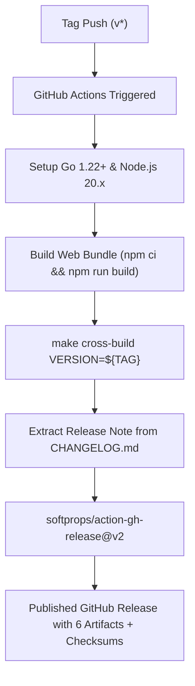

# [GOS-42] GitHub Actions 릴리즈 배포 자동화 및 온보딩/공개 문서 강화 계획서

> **티켓 번호**: [GOS-42](https://joincdream.atlassian.net/browse/GOS-42)  
> **마일스톤**: v0.1.1 ~ v1.0.0 Release Readiness & Onboarding Polish  
> **상태**: 진행 중 (In Progress)  
> **담당 패키지 / 대상 파일**:  
> - [`.github/workflows/release.yml`](file:///home/yundream/myjob/cloit/Goslide/.github/workflows/release.yml) *(신규: 태그 푸시 기반 자동 크로스 빌드 및 GitHub Releases 발행)*  
> - [`install.sh`](file:///home/yundream/myjob/cloit/Goslide/install.sh) *(신규: Linux/macOS 원라이너 자동 설치 스크립트)*  
> - [`README.md`](file:///home/yundream/myjob/cloit/Goslide/README.md) / [`README.ko.md`](file:///home/yundream/myjob/cloit/Goslide/README.ko.md) *(공개 문서: 자체 업데이트, 다국어 플래그, Chrome 요구사항 명시)*  
> - [`QUICKSTART.md`](file:///home/yundream/myjob/cloit/Goslide/QUICKSTART.md) / [`QUICKSTART.ko.md`](file:///home/yundream/myjob/cloit/Goslide/QUICKSTART.ko.md) *(온보딩 퀵스타트 가이드 동기화)*  
> **연관 문서**:  
> - [`task/GOS-37.md`](file:///home/yundream/myjob/cloit/Goslide/task/GOS-37.md) *(인앱 셀프 업데이트 구현 완료)*  
> - [`task/GOS-18.md`](file:///home/yundream/myjob/cloit/Goslide/task/GOS-18.md) *(크로스 플랫폼 배포 및 E2E 검증)*  
> - [**`AGENTS.md`**](file:///home/yundream/myjob/cloit/Goslide/AGENTS.md) *(엔지니어링 가이드라인 & LLM 가드레일)*  

---

## 1. 개요 및 배경 (Context & Objective)

### 1.1 현상 및 문제의식
1. **수동 릴리즈 프로세스의 마찰과 휴먼 에러 리스크**:
   - 현재 저장소에는 CI 파이프라인(`.github/workflows/ci.yml`)만 존재하며 배포 워크플로우가 없습니다.
   - 개발자가 로컬에서 `make cross-build`를 실행한 후, GitHub 웹 UI에서 직접 태그를 찾아 릴리즈를 생성하고 6개 플랫폼 아티팩트(`*.tar.gz`, `*.zip`)와 `checksums.txt`를 수동 업로드해야 합니다.
   - 태그가 원격에 먼저 푸시된 상태에서 웹 UI로 새 릴리즈를 생성하려 할 때 `"tag name has already been taken"` 충돌 오류가 발생하거나, 아티팩트 누락/체크섬 불일치 등 릴리즈 실패 가능성이 상존합니다.
2. **신규 사용자의 설치 및 온보딩 마찰**:
   - 사용자가 Goslide를 처음 접했을 때 GitHub Releases 페이지에서 자신의 OS/CPU 아키텍처를 확인하고, 압축 해제, 실행 권한 부여(`chmod +x`), `PATH` 복사까지 총 5단계를 수동 수행해야 합니다.
   - 타 현대적 CLI 도구(`uv`, `rustup`, `fzf`)처럼 단 한 줄의 커맨드로 설치를 끝마치는 원라이너 스크립트(`install.sh`)가 부재합니다.
3. **신규 기능 및 런타임 제약에 대한 사용자 공개 문서 누락**:
   - 최신 버전인 GOS-37에서 구현된 **`goslide update` (인앱 자체 업데이트)** 기능과 `--lang` 다국어 플래그가 `README` 및 `QUICKSTART`에 누락되어 있습니다.
   - PDF/PPTX 변환 시 필요한 **Google Chrome (Headless Chrome)** 런타임 요구사항과, 의존성이 0%인 순수 HTML 슬라이드 기능 간의 구분이 명문화되지 않아 혼란을 줄 수 있습니다.

### 1.2 개발 목표 (Key Deliverables)
1. **완전 자동화된 릴리즈 파이프라인 구축 (`release.yml`)**:
   - `git push origin v*` 태그 푸시 즉시 GitHub Actions가 자동으로 크로스 빌드를 수행하고, `CHANGELOG.md`에서 해당 버전 릴리즈 노트를 추출하여 GitHub Releases에 아티팩트를 첨부 및 발행.
2. **원라이너 크로스 플랫폼 설치 스크립트 제공 (`install.sh`)**:
   - `curl -fsSL https://raw.githubusercontent.com/joincdream/goslide/main/install.sh | bash` 명령으로 OS/Arch를 자동 판별하여 `~/.local/bin/goslide`로 설치.
3. **공개 문서 및 온보딩 경험 최신화**:
   - `README.md`, `README.ko.md`, `QUICKSTART.md`, `QUICKSTART.ko.md`에 `goslide update`, `--lang`, `install.sh`, Chrome 요구조건 명시.

---

## 2. 상세 아키텍처 및 구현 설계

### 2.1 GitHub Actions 릴리즈 배포 워크플로우 (`.github/workflows/release.yml`)

#### 동작 흐름도 (Mermaid)


#### 워크플로우 명세 상세:
- **트리거**:
  ```yaml
  name: Release Pipeline
  on:
    push:
      tags:
        - 'v*'
  permissions:
    contents: write
  ```
- **Job 구성**:
  1. `actions/checkout@v4`: fetch-depth: 0 (태그 및 전체 커밋 로그 확보)
  2. `actions/setup-go@v5`: go-version: "1.22.x" (캐시 활성화)
  3. `actions/setup-node@v4`: node-version: 20.x (캐시 활성화)
  4. Web 빌드: `cd web && npm ci && npm run build`
  5. 크로스 아티팩트 빌드: `make cross-build VERSION=${{ github.ref_name }}`
  6. 릴리즈 노트 슬라이싱:
     ```bash
     python3 -c "
     import re, sys
     content = open('CHANGELOG.md').read()
     tag = '${{ github.ref_name }}'.lstrip('v')
     pattern = r'## \[(?:v)?' + re.escape(tag) + r'\][^\n]*\n(.*?)(?=\n## \[|\Z)'
     match = re.search(pattern, content, re.DOTALL)
     if match:
         open('release_notes.md', 'w').write(match.group(1).strip())
     else:
         open('release_notes.md', 'w').write('Release ${{ github.ref_name }}')
     "
     ```
  7. GitHub Release 등록: `softprops/action-gh-release@v2`
     - `body_path: release_notes.md`
     - `files: dist/*`
     - `draft: false`
     - `prerelease: false` (테스트 태그라도 update 검증을 위해 Latest 유지 또는 동적 분기)

---

### 2.2 원라이너 인스톨러 (`install.sh`)

#### 아키텍처 및 요구 사양:
1. **OS 감지**:
   - `OS="$(uname -s | tr '[:upper:]' '[:lower:]')"`
   - 지원: `linux`, `darwin` (Windows는 PowerShell 안내)
2. **Architecture 감지**:
   - `ARCH="$(uname -m)"`
   - `x86_64` $\rightarrow$ `amd64`
   - `arm64`, `aarch64` $\rightarrow$ `arm64`
3. **최신 버전 자동 탐색 & 다운로드**:
   - GitHub API: `https://api.github.com/repos/joincdream/goslide/releases/latest`
   - 아티팩트 이름: `goslide_${OS}_${ARCH}.tar.gz`
   - 임시 디렉토리(`mktemp -d`)에서 다운로드 및 `tar -xzf`
4. **설치 디렉토리 및 권한**:
   - `INSTALL_DIR="${GOSLIDE_INSTALL_DIR:-$HOME/.local/bin}"`
   - 디렉토리 자동 생성(`mkdir -p "$INSTALL_DIR"`)
   - `install -m 0755 goslide "$INSTALL_DIR/goslide"`
   - macOS의 경우 Gatekeeper 격리 속성 제거: `xattr -d com.apple.quarantine "$INSTALL_DIR/goslide" 2>/dev/null || true`
5. **PATH 환경 변수 검증**:
   - `case ":$PATH:" in *":$INSTALL_DIR:"*) ... ;; *) echo "경고: PATH에 ~/.local/bin 추가 필요" ;; esac`

---

### 2.3 공개 문서(Docs) 및 온보딩 가이드 동기화

#### 1) `README.md` & `README.ko.md`
- **Installation 섹션 최상단 개편**:
  ```bash
  # Linux & macOS One-Liner Install
  curl -fsSL https://raw.githubusercontent.com/joincdream/goslide/main/install.sh | bash
  ```
- **Self-Update 섹션 신설**:
  ```bash
  # In-App Self-Update
  goslide update

  # Check for updates without upgrading
  goslide update --check
  ```
- **다국어 플래그(`--lang`) 안내**:
  - `goslide --lang=ko [command]` / `goslide --lang=en [command]`
- **Headless Chrome 런타임 요구조건 명시**:
  - HTML 슬라이드 및 라이브 프리뷰는 CGO 0%, 외부 의존성 0%
  - PDF 및 PPTX 벡터 변환 시 Google Chrome / Chromium 필요

#### 2) `QUICKSTART.md` & `QUICKSTART.ko.md`
- Step 0 설치 가이드에 원라이너 스크립트 반영.
- 신규 서브커맨드(`goslide update`, `goslide init`)의 온보딩 흐름 연동.

---

## 3. 구현 로드맵 및 단계별 작업 (Action Plan)

| 단계 | 작업 내용 | 결과 산출물 | 상태 |
| :---: | :--- | :--- | :---: |
| **Phase 1** | **릴리즈 자동화 워크플로우 구축**<br>- `.github/workflows/release.yml` 작성<br>- Node.js Svelte 빌드, 크로스 패키징, 릴리즈 노트 슬라이싱 연동 | `.github/workflows/release.yml` | 대기 중 |
| **Phase 2** | **원라이너 인스톨 스크립트 작성**<br>- OS/Arch 자동 판별, 다운로드, 무결성 검증, PATH 안내 스크립트 | `install.sh` | 대기 중 |
| **Phase 3** | **공개 문서 동기화 및 온보딩 보강**<br>- `README.md`, `README.ko.md`, `QUICKSTART.md`, `QUICKSTART.ko.md`<br>- `goslide update`, `--lang`, Chrome 의존성 가이드 추가 | `README*.md`, `QUICKSTART*.md` | 대기 중 |
| **Phase 4** | **E2E 릴리즈 파이프라인 검증**<br>- 테스트 태그 발행을 통한 GitHub Actions 자동 빌드/업로드 검증<br>- `install.sh` 및 `goslide update` 실동작 E2E 확인 | GitHub Release & CLI 검증 | 대기 중 |

---

## 4. 완료 조건 (Definition of Done)

1. [ ] **GitHub Actions 릴리즈 배포 검증**:
   - `git push origin vX.Y.Z` 시 GitHub Actions가 오류 없이 동작하여 릴리즈를 발행하고 6개 플랫폼 아티팩트 및 `checksums.txt`가 에셋으로 온전히 등록되어야 함.
2. [ ] **`install.sh` 설치 검증**:
   - Linux 및 macOS 환경에서 `install.sh` 스크립트를 통해 단일 바이너리가 정상 설치되고 실행되어야 함.
3. [ ] **공개 문서 정확도**:
   - `README` 및 `QUICKSTART`의 한/영 문서 모두 최신 CLI 기능(`goslide update`, `--lang`) 및 시스템 요구조건(Chrome)이 정확히 기재되어 있어야 함.
