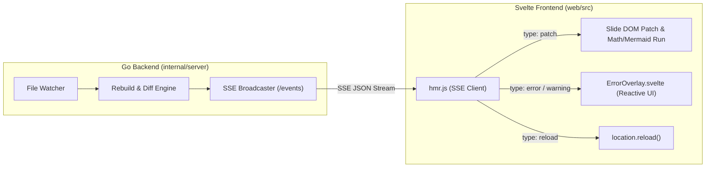

# [GOS-43] Live Reload/오버레이 프론트엔드(Svelte) 이관 및 server.go 모듈화 계획서

> **티켓 번호**: [GOS-43](https://joincdream.atlassian.net/browse/GOS-43)  
> **마일스톤**: v1.0.0 Architecture Polish & Separation of Concerns  
> **상태**: 할 일 (To Do)  
> **담당 패키지 / 대상 디렉토리**:  
> - [`web/src/`](file:///home/yundream/myjob/cloit/Goslide/web/src/) *(Svelte 5: Live Reload SSE 클라이언트 및 에러/경고 오버레이 컴포넌트 통합)*  
> - [`internal/server/`](file:///home/yundream/myjob/cloit/Goslide/internal/server/) *(Go 백엔드: sseScript 165줄 삭제 및 단일 책임 파일 분리)*  
> **연관 문서**:  
> - [`docs/okf/decisions-simplification.md`](file:///home/yundream/myjob/cloit/Goslide/docs/okf/decisions-simplification.md) *(ADR-001: 아키텍처 단순화 및 YAGNI 원칙)*  
> - [`docs/okf/core-architecture.md`](file:///home/yundream/myjob/cloit/Goslide/docs/okf/core-architecture.md) *(하이브리드 SSG 및 프론트엔드/백엔드 경계)*  
> - [**`AGENTS.md`**](file:///home/yundream/myjob/cloit/Goslide/AGENTS.md) *(엔지니어링 가이드라인 & LLM 가드레일)*  

---

## 1. 개요 및 배경 (Context & Objective)

### 1.1 현상 및 문제의식 (Technical Debt)
1. **프론트엔드와 백엔드의 관심사 분리(SoC) 왜곡**:
   * Goslide의 프론트엔드 인터랙션(발표자 콘솔, 판서 툴바, 단축키 처리 등)은 원래 [`web/`](file:///home/yundream/myjob/cloit/Goslide/web/)의 **Svelte 5** 컴포넌트로 관리되고 있습니다.
   * 그러나 개발 서버(`goslide serve`)의 핫리로드(HMR)와 에러 토스트 화면은 Svelte에 통합되지 않고, **순수 JavaScript/HTML DOM 조작 코드 165줄(`const sseScript = ...`)이 Go 백엔드 소스코드([internal/server/server.go](file:///home/yundream/myjob/cloit/Goslide/internal/server/server.go))에 raw string으로 하드코딩**되어 있습니다.
2. **`server.go`의 비대화 및 God File 안티패턴**:
   * 현재 `server.go`는 총 **718라인**에 달하며, 다음과 같이 5가지의 완전히 다른 책임이 단일 파일에 엉켜 있습니다:
     * 브라우저 클라이언트 JS (165줄)
     * 파일 변경 감지 및 HMR 재빌드/스냅샷 디스패처 (135줄)
     * HTTP 라우팅 및 정적 에셋 서빙 (120줄)
     * SSE 연결 풀 및 브로드캐스터 (110줄)
     * TCP 리스너 및 서버 수명주기 (188줄)
3. **유지보수성 및 개발 생산성 저하**:
   * Go 문자열 내부에 자바스크립트가 들어있어 IDE의 린트, 타입체크, 구문 강조를 전혀 받지 못하며, 브라우저 UI 로직이 Svelte와 Go 양쪽으로 파편화되어 있습니다.

### 1.2 개발 목표 (Key Deliverables)
1. **Live Reload / HMR 브라우저 로직 Svelte 프론트엔드 완전 이관**:
   * `server.go` 내의 165줄짜리 `sseScript`를 완전히 삭제.
   * SSE 수신, 슬라이드 DOM 패치, KaTeX/Mermaid 런타임 갱신, 에러 모달 및 경고 토스트 UI를 **Svelte 5 컴포넌트(`web/src/components/ErrorOverlay.svelte`, `web/src/lib/hmr.js`)로 재구현하여 통합 번들(`goslide-core.js`)에 포함**.
2. **Go 백엔드(`internal/server`)의 순수 API화 및 파일 모듈화**:
   * Go 백엔드는 브라우저 UI에 관여하지 않고, 오직 `/events` 엔드포인트를 통해 JSON 규격의 HMR 이벤트(`reload`, `patch`, `error`, `warning`)만 발행하는 순수 이벤트 브로커로 단순화.
   * `server.go`를 4개의 단일 책임 파일로 분리하여 **본체 라인 수를 718줄 ➔ 약 180줄로 75% 다이어트**.

---

## 2. 상세 아키텍처 및 구현 설계

### 2.1 프론트엔드 Svelte 5 통합 설계 ([`web/src/`](file:///home/yundream/myjob/cloit/Goslide/web/src/))

#### 아키텍처 흐름도 (Mermaid)


#### 세부 구성 요소:
1. **`web/src/lib/hmr.js` (SSE 클라이언트 모듈)**:
   * 개발 서버 접속 시 `/events`에 대한 `EventSource` 자동 연결.
   * `patch` 이벤트 수신 시 해당 슬라이드 DOM 요소를 부드럽게 교체하고 `KaTeX` / `Mermaid` 런타임 재실행.
   * Svelte `DeckStore`에 `goslide:slide-patched` 이벤트를 디스패치하여 발표자 뷰와 상태 동기화.
2. **`web/src/components/ErrorOverlay.svelte` (에러/진단 토스트 반응형 컴포넌트)**:
   * 마크다운 문법 오류 발생 시 풀스크린 에러 오버레이 렌더링.
   * 권장 문법 진단(`diagnostics`) 발생 시 우측 상단 플로팅 앰버(Amber) 토스트 알림 렌더링.
   * Tailwind CSS 및 Svelte 전환 애니메이션(`transition:fade`) 적용으로 일관된 UI/UX 제공.

---

### 2.2 Go 백엔드 모듈 분리 설계 ([`internal/server/`](file:///home/yundream/myjob/cloit/Goslide/internal/server/))

Go의 동일 패키지(`package server`) 규칙을 활용하여, 외부 공개 API나 동작 변경 없이 내부 소스 파일을 4개로 명확히 분리합니다:

```
internal/server/
├── server.go        # [서버 수명주기] Server/Config 선언, NewServer, Start, Close, openBrowser (~180줄)
├── handler.go       # [HTTP 핸들러] Handler, handleRoot, serveSlideHTML, serveStaticAsset (~120줄)
├── sse.go           # [SSE 브로드캐스터] EventType, SSEMessage, handleEvents, Broadcast* 메서드 (~100줄)
├── watcher_loop.go  # [HMR 디스패처] watchLoop, handleFileChange, rebuildAndWarmCache, reconcileSnapshot (~130줄)
├── hmr.go           # [스냅샷 비교] 기존 DeckSnapshot 및 CompareSnapshots 유지 (~140줄)
└── watcher.go       # [파일 감시기] 기존 Watcher 구조체 유지 (~120줄)
```

#### 각 파일별 상세 역할:
1. **`server.go` (대폭 경량화)**:
   * `const sseScript` 완전 제거 (165줄 삭제).
   * `Server`, `Config` 정의 및 네트워크 리스너 바인딩, 우아한 종료(Graceful Shutdown) 전담.
2. **`handler.go`**:
   * HTTP `ServeMux` 등록 및 슬라이드 HTML 렌더링 응답.
   * 로컬 이미지 및 상대 경로 정적 리소스 서빙.
3. **`sse.go`**:
   * 클라이언트 채널 풀(`map[chan string]struct{}`) 동기화 관리.
   * `BroadcastMessage`, `BroadcastPatches`, `BroadcastWarnings`, `BroadcastReload`, `BroadcastError`.
4. **`watcher_loop.go`**:
   * 파일 변경 이벤트 발생 시 비동기 디스패치 루프.
   * 마크다운 재파싱, 슬라이드 스냅샷 비교(`CompareSnapshots`) 및 HMR 패치/전체 리로드 결정.

---

## 3. 구현 로드맵 및 단계별 작업 (Action Plan)

| 단계 | 작업 내용 | 결과 산출물 | 상태 |
| :---: | :--- | :--- | :---: |
| **Phase 1** | **Svelte 프론트엔드 HMR & 오버레이 구현**<br>- `web/src/lib/hmr.js` 및 `ErrorOverlay.svelte` 작성<br>- `App.svelte`에 HMR 클라이언트 및 오버레이 컴포넌트 마운트<br>- Svelte 빌드 (`npm run build`) | `web/src/lib/hmr.js`<br>`web/src/components/ErrorOverlay.svelte` | 준비 중 |
| **Phase 2** | **Go 백엔드 sseScript 제거 및 모듈 분리**<br>- `server.go`에서 `sseScript` 165줄 완전 삭제<br>- `handler.go`, `sse.go`, `watcher_loop.go`로 관심사 분리<br>- `injectSSEScript` 삭제 및 순수 슬라이드 HTML 응답 | `internal/server/` 모듈 4종 | 준비 중 |
| **Phase 3** | **단위 테스트 및 HMR 회귀 검증**<br>- 기존 `server_test.go`, `hmr_test.go` 전체 통과 검증<br>- SSE 이벤트 직렬화 및 브로드캐스트 정합성 확인 | 단위 테스트 PASS | 준비 중 |
| **Phase 4** | **품질 분석 및 최종 릴리즈 준비**<br>- `make check` (gofmt, go vet, gocyclo, test-race) 전원 통과<br>- `server.go` 라인 수 감소(<200줄) 확인 | Well-Architected PASS | 준비 중 |

---

## 4. 완료 조건 (Definition of Done)

1. [ ] **코드 다이어트 달성**:
   - `server.go` 본체의 라인 수가 **200라인 이하**로 축소되어야 함.
   - `server.go` 내부에 Raw String 형태의 HTML/JavaScript 코드가 0줄이어야 함.
2. [ ] **프론트엔드 일원화**:
   - 에러 토스트, 경고 팝업, DOM 패치 로직이 `web/` Svelte 5 프론트엔드에서 완전히 일관되게 제어되어야 함.
3. [ ] **기능 무결성 및 무중단 HMR**:
   - `goslide serve` 실행 시 슬라이드 수정 ➔ 브라우저 부분 갱신(HMR), 문법 오류 ➔ 에러 모달 노출이 기존과 완벽히 동일하게 동작해야 함.
4. [ ] **품질 가드레일 준수**:
   - `make check` (린트, 복잡도 <= 15, 레이스 컨디션 0) 완전 통과.
