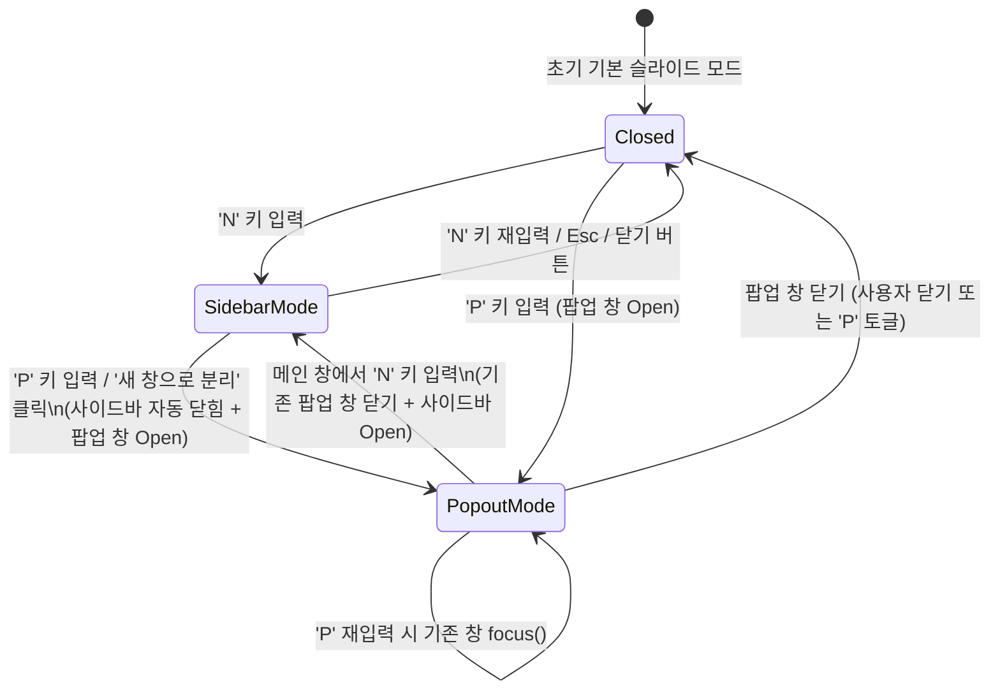

# [GOS-44] 발표자 뷰 인라인('N') 및 팝아웃('P') 모드 상호 배타적(Mutually Exclusive) 전환 제어 개선

> **티켓 번호**: [GOS-44](https://joincdream.atlassian.net/browse/GOS-44)  
> **마일스톤**: v1.0.0 UX Polish & Presentation Safety  
> **상태**: 완료 (Done)  
> **담당 패키지 / 대상 디렉토리**:  
> - [`web/src/components/PresenterSidebar.svelte`](file:///home/yundream/myjob/cloit/Goslide/web/src/components/PresenterSidebar.svelte) *(팝아웃 창 인스턴스 관리, 분리 시 사이드바 자동 닫기)*  
> - [`web/src/components/KeyboardHandler.svelte`](file:///home/yundream/myjob/cloit/Goslide/web/src/components/KeyboardHandler.svelte) *(단축키 'N', 'P' 상호 배타적 토글 제어)*  
> - [`web/src/stores/deck.svelte.js`](file:///home/yundream/myjob/cloit/Goslide/web/src/stores/deck.svelte.js) *(필요 시 팝아웃 활성화 상태 추적 및 반응형 상태 동기화)*  
> **연관 문서**:  
> - [`docs/okf/screencast-annotation.md`](file:///home/yundream/myjob/cloit/Goslide/docs/okf/screencast-annotation.md) *(발표자 콘솔 및 프론트엔드 인터랙션)*  
> - [`docs/okf/decisions-simplification.md`](file:///home/yundream/myjob/cloit/Goslide/docs/okf/decisions-simplification.md) *(ADR-001: 단순화 및 일관성 원칙)*  
> - [**`AGENTS.md`**](file:///home/yundream/myjob/cloit/Goslide/AGENTS.md) *(엔지니어링 가이드라인 & LLM 가드레일)*  

---

## 1. 개요 및 배경 (Context & Objective)

### 1.1 현상 및 문제의식 (Technical Debt & Safety Risk)
1. **발표자 뷰의 중복 활성화 및 상호 배타성 결여**:
   - Goslide의 발표자 지원 기능은 두 가지 뷰 모드를 지원합니다:
     - **인라인 사이드바 모드 (`N`)**: 슬라이드 화면 우측에 480px 폭의 사이드바 드로어(Drawer)를 렌더링.
     - **독립 팝업 윈도우 모드 (`P`)**: `window.open`을 통해 별도의 브라우저 창으로 전체 발표자 콘솔(Live, Next, Notes, Toolbar)을 띄움.
   - 현재는 'N' 모드가 활성화된 상태에서 'P'를 누르면, 기존 사이드바가 닫히지 않고 열린 상태 그대로 팝업 창이 별도로 생성됩니다.
2. **프레젠테이션 실무에서의 치명적인 청중 노출 위험**:
   - 발표자가 'P' 모드를 실행하는 목적은 메인 화면(빔 프로젝터나 외부 모니터 송출용)에는 슬라이드만 깨끗하게 표시하고, 본인의 노트북 화면에 발표자 콘솔을 띄우려는 것입니다.
   - 메인 화면에 480px 사이드바가 계속 켜져 있으면 **발표자 대본(Notes)과 다음 슬라이드가 청중에게 그대로 노출되는 치명적인 발표 사고**가 발생합니다.
3. **'새 창으로 분리(Pop-out)' 메타포 위반 및 리소스 낭비**:
   - 사이드바 상단 버튼의 의미 자체가 "인라인 패널을 창 밖으로 떼어낸다(Detach)"는 메타포이므로, 팝아웃 시 기존 사이드바는 자동으로 접혀야 합니다.
   - 두 모드가 동시에 켜져 있으면 `1920×1080` 축소 슬라이드 렌더링과 `BroadcastChannel` 타이머/상태 동기화 연산이 2중으로 돌아가 불필요한 GPU/CPU 리소스를 낭비합니다.

### 1.2 개발 목표 (Key Deliverables)
1. **팝아웃('P') 실행 시 인라인 사이드바 자동 비활성화**:
   - 단축키 'P' 또는 사이드바 상단 '새 창으로 분리' 버튼 클릭 시, 인라인 사이드바를 즉시 닫음(`deck.toggleSidebar(false)`).
2. **팝업 창 싱글톤(Singleton) 참조 관리 및 스마트 포커스**:
   - 팝업 창이 이미 열려 있는 상태에서 'P'를 다시 누를 경우, 중복 창을 띄우지 않고 기존 열려 있는 팝업 창에 포커스(`popoutWin.focus()`).
3. **상호 배타적 전환(Mutually Exclusive Switch) 정책 확립**:
   - 팝업 창이 열려 있는 상태에서 메인 창에서 'N'을 누를 경우, 팝업 창을 닫고 사이드바를 열거나 사용자 혼선이 없도록 상태를 정리.
   - 팝업 창이 사용자에 의해 닫혔을 때(`window.onbeforeunload` 또는 감시) 상태를 정상화하여 깨끗한 생명주기 보장.

---

## 2. 상세 설계 (Architecture & Implementation Design)

### 2.1 상태 전이 다이어그램 (State Machine)



---

### 2.2 컴포넌트별 세부 변경 설계

#### 1) `web/src/components/PresenterSidebar.svelte`
- **팝업 창 인스턴스 참조 변수 관리**:
  ```javascript
  let popoutWindow = null;
  ```
- **`openPopout()` 함수 개선**:
  - 이미 `popoutWindow`가 열려 있고 닫히지 않은 경우(`popoutWindow && !popoutWindow.closed`), 새 창을 생성하지 않고 기존 창을 포커스:
    ```javascript
    if (popoutWindow && !popoutWindow.closed) {
      popoutWindow.focus();
      deck.toggleSidebar(false);
      return;
    }
    ```
  - 새 팝업 창 생성 후 인스턴스 저장:
    ```javascript
    popoutWindow = window.open('', 'goslide-presenter-' + window.location.pathname, 'width=1100,height=750');
    // ... HTML 렌더링 ...
    // 사이드바 자동 비활성화 (상호 배타적 전환)
    deck.toggleSidebar(false);
    ```
  - 팝업 창 닫힘 감지 리스너 등록:
    ```javascript
    popoutWindow.addEventListener('beforeunload', () => {
      popoutWindow = null;
    });
    ```
- **외부 공개 인터페이스(Export) 추가**:
  - `closePopout()`: 팝업 창이 열려 있을 경우 닫는 메서드 제공.
  - `isPopoutOpen()`: 현재 팝업 창이 활성화되어 있는지 여부 반환.

#### 2) `web/src/components/KeyboardHandler.svelte` & `web/src/App.svelte`
- **'N' 단축키 핸들러 보강**:
  - 팝아웃 창이 열려 있는 상태에서 'N'을 누르면, 열려 있던 팝아웃 창을 닫고 메인 창 사이드바를 띄우도록 상호 배타성 보장:
    ```javascript
    case 'n':
    case 'N':
      e.preventDefault();
      if (sidebarComponent && sidebarComponent.isPopoutOpen()) {
        sidebarComponent.closePopout();
      }
      deck.toggleSidebar();
      break;
    ```
- **'P' 단축키 핸들러**:
  - 기존 사이드바 닫기 및 팝아웃 열기/포커스를 일관되게 `sidebarComponent.openPopout()`으로 위임.

---

## 3. 단계별 작업 계획 (WBS)

| 단계 | 작업 내용 | 대상 파일 | 검증 기준 |
| :--- | :--- | :--- | :--- |
| **Step 1** | **팝아웃 실행 시 사이드바 자동 비활성화**<br>- `openPopout()` 내 `deck.toggleSidebar(false)` 호출<br>- 툴바/헤더의 '새 창으로 분리' 버튼 클릭 이벤트 연동 | `PresenterSidebar.svelte` | 'N'으로 사이드바를 연 상태에서 'P'를 누르면 사이드바가 즉시 닫히고 팝업만 표시되는지 확인 |
| **Step 2** | **팝업 창 싱글톤 참조 및 스마트 포커스**<br>- `popoutWindow` 인스턴스 캐싱<br>- 이미 열려 있을 때 'P' 재입력 시 중복 생성 방지 및 기존 창 `focus()` 호출 | `PresenterSidebar.svelte` | 'P'를 연타해도 팝업 창이 1개만 유지되며 포커스 이동하는지 확인 |
| **Step 3** | **'N' ↔ 'P' 상호 배타적 전환 및 팝업 닫힘 생명주기**<br>- `closePopout()` 및 `isPopoutOpen()` 메서드 구현<br>- 'N' 입력 시 팝업 창 정리 후 사이드바 오픈<br>- 팝업 창 종료 시 참조 초기화 | `PresenterSidebar.svelte`<br>`App.svelte`<br>`KeyboardHandler.svelte` | 팝업 창이 뜬 상태에서 'N'을 누르면 팝업이 닫히고 사이드바가 부드럽게 열리는지 확인 |
| **Step 4** | **수동 인터랙션 및 프레젠테이션 E2E 검증**<br>- 타이머 및 슬라이드 넘김 동기화 정상 동작 확인<br>- 메모 글자 크기 변경 및 판서 툴바 연동 확인 | 프론트엔드 전반 | 화면 중복 없이 1개 뷰만 안정적으로 유지되는지 확인 |

---

## 4. 검증 체크리스트 (Verification Scenarios)

1. [ ] **시나리오 1: N ➔ P 전환**
   - 슬라이드에서 'N'을 눌러 우측 사이드바가 열려 있는 상태에서 'P'를 누른다.
   - **기대 결과**: 사이드바가 슬라이드 인 애니메이션과 함께 닫히고, 독립 팝업 콘솔 창이 화면 전면에 정상 표시된다.
2. [ ] **시나리오 2: 팝아웃 버튼 클릭**
   - 사이드바 상단의 '새 창으로 분리 (P)' 아이콘 버튼을 클릭한다.
   - **기대 결과**: 사이드바가 닫히며 팝업 창이 뜬다.
3. [ ] **시나리오 3: 팝업 중복 생성 방지**
   - 팝업 창이 열린 상태에서 메인 창을 클릭한 뒤 다시 'P'를 누른다.
   - **기대 결과**: 새로운 창이 추가로 뜨지 않고, 이미 열려 있는 팝업 창으로 포커스가 즉시 이동한다.
4. [ ] **시나리오 4: P ➔ N 전환**
   - 팝업 창이 열린 상태에서 메인 창에서 'N'을 누른다.
   - **기대 결과**: 외부 팝업 창이 닫히고, 메인 화면 우측에 사이드바가 열린다.
5. [ ] **시나리오 5: Esc 키 처리**
   - 사이드바 열림 상태에서 'Esc'를 누르면 사이드바만 닫히며, 슬라이드 제어권이 온전히 유지된다.
