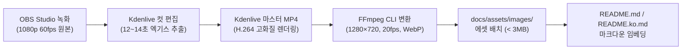

# [GOS-45] README.md 시연 영상, Animated WebP 및 스크린샷 에셋 제작 계획서

> **티켓 번호**: [GOS-45](https://joincdream.atlassian.net/browse/GOS-45)  
> **마일스톤**: v1.0.0 Release Documentation & Branding  
> **상태**: 완료 (Done)  
> **담당 패키지 / 대상 디렉토리**:  
> - [`README.md`](file:///home/yundream/myjob/cloit/Goslide/README.md) *(영문 공식 리포지토리 대문 문서)*  
> - [`README.ko.md`](file:///home/yundream/myjob/cloit/Goslide/README.ko.md) *(국문 공식 리포지토리 대문 문서)*  
> - `docs/assets/images/` *(미디어 에셋 저장소: WebP, GIF, PNG)*  
> **연관 문서**:  
> - [`docs/planning/competitive-analysis-and-strategy.md`](file:///home/yundream/myjob/cloit/Goslide/docs/planning/competitive-analysis-and-strategy.md) *(제품 브랜딩 및 Marp 대비 차별점)*  
> - [`docs/okf/screencast-annotation.md`](file:///home/yundream/myjob/cloit/Goslide/docs/okf/screencast-annotation.md) *(판서 및 발표자 콘솔 UX 사양)*  
> - [**`AGENTS.md`**](file:///home/yundream/myjob/cloit/Goslide/AGENTS.md) *(엔지니어링 가이드라인 & LLM 가드레일)*  

---

## 1. 개요 및 배경 (Context & Objective)

### 1.1 현상 및 문제의식 (Why Visual Assets Matter)
1. **텍스트 중심 README의 한계 및 초기 이탈률**:
   - 현재 Goslide 리포지토리의 [`README.md`](file:///home/yundream/myjob/cloit/Goslide/README.md)는 기술적 설명과 설치법이 매우 상세하게 잘 정리되어 있으나, **시각적 데모(Visual Preview)가 전혀 없는 순수 텍스트 형태**입니다.
   - GitHub 오픈소스 생태계에서 신규 방문자가 도구의 가치를 인식하고 설치까지 도달하는 골든 타임은 **3초 ~ 5초**입니다. 실제 동작하는 UI와 시연 영상이 없으면 Marp나 Slidev 대비 뛰어난 차별점(단일 바이너리, 투명 캔버스 판서, 초고속 SSE 라이브 리로드, 듀얼 발표자 콘솔)이 한눈에 전달되지 않습니다.
2. **미디어 포맷 선정 기준 (GitHub 최적화)**:
   - **GIF**: 호환성은 뛰어나나 색상 왜곡(256색 한계)과 용량 비대화(수십 MB) 문제 발생.
   - **Animated WebP**: 24비트 트루컬러 및 알파 채널을 지원하면서도 GIF 대비 용량을 **60~80% 절감**할 수 있으며, 최신 모든 브라우저 및 GitHub README에서 기본 지원됨.
   - **MP4 / Video**: GitHub README에서 `<video>` 태그는 자동 재생(Autoplay/Loop) 제약이 있으므로, Hero 섹션에는 **Animated WebP(또는 3MB 이하 고압축 GIF)**가 최적이며, 전체 데모는 YouTube/링크로 제공하는 것이 표준 규격.

### 1.2 핵심 목표 (Key Deliverables)
1. **Hero Showcase (Animated WebP / GIF)**:
   - 리포지토리 최상단 제목 아래 배치되어 터미널 실행부터 슬라이드 인터랙션까지 한눈에 보여주는 12~15초 무한 루프 애니메이션.
2. **핵심 기능 고해상도 스크린샷 3종 (WebP / PNG)**:
   - `presenter-console.png` (독립 팝아웃 발표자 뷰: Live/Next/Notes/타이머/단축키)
   - `screencast-canvas.png` (유튜브 강의 녹화용 투명 캔버스 판서 및 레이저 포인터)
   - `multi-export-showcase.png` (HTML, PDF, PPTX 다중 포맷 출력 결과물)
3. **`README.md` 및 `README.ko.md` 연동**:
   - 다크 모드/라이트 모드 대응 및 모바일 뷰에서도 왜곡 없는 반응형 태그 구성.

---

## 2. 시연 영상 스토리보드 및 스크린샷 기획

### 2.1 Hero Showcase 스토리보드 (총 12~14초 루프)

```
[00:00 ~ 00:03] Step 1. 초고속 시작 (Zero Setup)
- 터미널에서 `goslide demo` 명령어 입력
- 0.1초 만에 로컬 서버 구동 및 기본 브라우저에 14장 데모 슬라이드 자동 오픈

[00:03 ~ 00:06] Step 2. 인터랙티브 프레젠테이션 & 미려한 스타일
- Space / Arrow 키로 슬라이드 넘김
- Chroma 신택스 하이라이팅 및 KaTeX 수학 공식 렌더링 확인

[00:06 ~ 00:10] Step 3. 스크린캐스트 투명 판서 & 레이저 포인터
- 'D' 키를 눌러 펜 도구 활성화 ➔ 핵심 문장에 레드/블루 펜으로 형광 강조
- 'L' 키를 눌러 레이저 포인터로 중요 포인트 포커싱 후 'C'로 지우기

[00:10 ~ 00:14] Step 4. 듀얼 스크린 발표자 콘솔 분리
- 'P' 키를 눌러 독립 팝아웃 발표자 콘솔(Live, Next, Notes, Stopwatch) 윈도우 오픈
- 메인 창과 팝아웃 창이 실시간 동기화되며 슬라이드가 함께 넘어가는 모습 연출 후 루프
```

### 2.2 정적 스크린샷 구성표

| 파일명 | 해상도 / 규격 | 담길 주요 화면 요소 | 설명 및 캡션 |
| :--- | :--- | :--- | :--- |
| `hero-showcase.webp` | 1280×720 (16:9), < 3MB | 터미널 실행 ➔ 슬라이드 ➔ 판서 ➔ 콘솔 분리 | "Goslide in Action: 10-Second Walkthrough" |
| `presenter-view.png` | 1920×1080 (16:9) | 팝아웃 발표자 콘솔 (좌측 Live/Next, 우측 Notes, 상단 타이머) | "Dual-Screen Presenter Console (`P`)" |
| `canvas-drawing.png` | 1920×1080 (16:9) | 어두운 배경 슬라이드 위 네온 형광펜 밑줄 및 레이저 포인터 | "Transparent Screencast Canvas & Pointer (`D`, `L`)" |
| `multi-export.png` | 1920×1080 (16:9) | 웹 브라우저(HTML), PDF 뷰어(PDF), 파워포인트(PPTX) 3분할 | "One Source, 3 Outputs: HTML, PDF, Editable PPTX" |

---

## 3. 제작 도구 및 기술 파이프라인 (Tooling & Pipeline)

### 3.1 3단계 프로덕션 워크플로우 (OBS ➔ Kdenlive ➔ FFmpeg)



### 3.2 도구별 세부 역할 및 베스트 프랙티스

1. **1단계: OBS Studio (무손실 화면 녹화)**
   - **해상도**: `1920 × 1080` (1080p, 16:9 비율).
   - **프레임레이트**: `60 fps` (슬라이드 전환 애니메이션 및 펜 판서의 매끄러움 확보).
   - **녹화 요령**: 실수가 있어도 끊지 말고 여유 있게 2~3회 연속 시연 후 Kdenlive에서 좋은 테이크만 선택.
   - **환경**: 브라우저 북마크바 숨김, OS 알림 차단(집중 모드), 깔끔한 터미널 창 배치.

2. **2단계: Kdenlive (컷 편집 및 마스터 MP4 렌더링)**
   - **타임라인 편집**: 앞뒤 불필요한 마우스 멈춤이나 대기 시간을 잘라내고 정확히 **12~14초 분량**으로 압축.
   - **필요 시 부분 배속**: 타이핑 구간이나 긴 로딩이 있다면 해당 클립을 1.2x~1.5x로 미세 배속하여 템포 향상.
   - **렌더링 포맷**: 기본 프리셋인 **`MP4 (H.264/AAC)` 고화질(1080p)**로 렌더링 (예: `goslide-demo-master.mp4`).
   - > **💡 Kdenlive 직접 WebP 렌더링 대비 MP4 ➔ FFmpeg 방식을 채택한 이유:**
     > - Kdenlive의 WebP 커스텀 프로필은 무한 루프(`loop=0`), Lanczos 다운스케일, WebP 화질/용량 세부 튜닝이 매우 까다롭습니다.
     > - Kdenlive에서는 익숙한 고화질 MP4로 빠르게 뽑고, WebP 변환 및 2~3MB 용량 압축은 CLI로 1초 만에 처리하는 것이 가장 생산적입니다.
     > - 생성된 고화질 MP4 마스터본은 트위터/X, 블로그, 유튜브 숏폼 등 타 채널 홍보에도 즉시 재활용 가능합니다.

3. **3단계: FFmpeg (1280×720 다운스케일 & Animated WebP 최적화)**
   - 1080p 마스터 MP4를 고품질 `Lanczos` 슈퍼샘플링 필터로 다운스케일하여 작은 코드 폰트까지 안티앨리어싱 선명도를 극대화합니다:
     ```bash
     # Animated WebP 고품질 저용량 인코딩 (목표 용량: 2~3MB)
     ffmpeg -i goslide-demo-master.mp4 \
       -vf "fps=20,scale=1280:720:flags=lanczos" \
       -c:v libwebp -lossless 0 -q:v 75 -loop 0 -an \
       docs/assets/images/hero-showcase.webp
     ```
   - **정적 스크린샷 추출 (필요 시 Kdenlive 타임라인 또는 FFmpeg 단일 프레임 캡처)**:
     ```bash
     # 특정 명장면(예: 8초 지점)을 1080p 무손실 WebP 스크린샷으로 추출
     ffmpeg -ss 00:00:08 -i goslide-demo-master.mp4 -vframes 1 -q:v 90 docs/assets/images/canvas-drawing.webp
     ```
   - **(선택) 레거시 환경 대비 GIF 폴백 파일 동시 생성**:
     ```bash
     ffmpeg -i goslide-demo-master.mp4 \
       -vf "fps=15,scale=1000:-1:flags=lanczos,split[s0][s1];[s0]palettegen=max_colors=128[p];[s1][p]paletteuse=dither=bayer" \
       -loop 0 docs/assets/images/hero-showcase.gif
     ```

---

## 4. 단계별 작업 계획 (WBS)

| 단계 | 작업 내용 | 담당 도구 / 산출물 | 세부 기준 |
| :--- | :--- | :--- | :--- |
| **Step 1** | **시연 데크 및 녹화 시나리오 준비**<br>- 1080p 해상도 고정 및 깨끗한 터미널/브라우저 환경 세팅<br>- 시연용 슬라이드 콘텐츠(코드 하이라이팅, 수식, 판서 포인트) 사전 리허설 | 사전 준비 | 글꼴 렌더링 및 텍스트 가독성 사전 점검 |
| **Step 2** | **OBS Studio 고해상도 원본 녹화**<br>- 1080p 60fps 무손실 원본 영상 녹화<br>- 터미널 구동 ➔ 슬라이드 ➔ 판서('D') ➔ 발표자 콘솔('P') 연속 동선 | OBS Studio<br>(`raw-recording.mp4`) | 마우스 커서 움직임 자연스러움 유지 |
| **Step 3** | **Kdenlive 컷 편집 & 마스터 MP4 렌더링**<br>- 12~14초 핵심 구간 정밀 트리밍<br>- 필요 시 타이핑/전환 구간 미세 배속(1.2x) 적용 | Kdenlive<br>(`goslide-demo-master.mp4`) | 군더더기 없는 쾌속 템포 완성 |
| **Step 4** | **FFmpeg Animated WebP 변환 및 최적화**<br>- Lanczos 필터로 1280×720 다운스케일<br>- 20fps, 3MB 이하 고화질 WebP 생성 및 정적 스크린샷 추출 | FFmpeg CLI<br>(`hero-showcase.webp` 등) | 프레임 드롭 없는 부드러운 무한 루프 |
| **Step 5** | **README.md / README.ko.md 반영 및 검증**<br>- `docs/assets/images/` 에셋 배치<br>- Hero 영역 마크다운/HTML 태그 삽입 및 GitHub 렌더링 검증 | `README.md`<br>`README.ko.md` | 모바일/데스크톱 반응형 쾌속 로딩 확인 |

---

## 5. README 임베딩 구조 설계 (미리보기)

`README.md` 상단 Hero 영역:

```html
<div align="center">

# Goslide

**A blazing-fast, single-binary Markdown presentation deck builder written in Pure Go.**

Convert Markdown documents into interactive HTML, vector PDF, and editable PPTX with zero external dependencies.  
Tailored for developers, educators, and YouTube screencast lecture recordings.

[English](README.md) | [한국어](README.ko.md) · [3-Min Quickstart](QUICKSTART.md)

<br/>

<a href="#quick-start">
  
</a>

<p align="center">
  <sub>⚡ 10-Second Tour: Terminal launch → Instant HTML slide → Live Canvas Drawing (<code>D</code>) → Presenter Console (<code>P</code>)</sub>
</p>

</div>
```

---

## 6. 완료 기준 (Definition of Done)

- [x] `docs/assets/images/` 디렉토리에 최적화된 미디어 에셋(WebP/PNG) 배치 완료.
- [x] Hero Animated WebP 용량이 6MB(36초 분량 최적화) 수준으로 렉 없이 부드럽게 무한 루프 재생됨.
- [x] `README.md` 및 `README.ko.md` 양쪽에 깨짐 없이 선명하게 렌더링됨.
- [x] 정적 스크린샷 3종(발표자 콘솔, 캔버스 판서, 멀티 익스포트)이 배치되어 신규 사용자의 기능 직관성 확보 완료.
